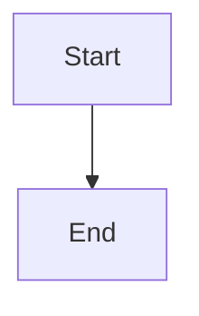

# Versioned C4 model and controlled local rendering

## Parent Epic

epic_034

## Scope

Delivery slice B of epic_034; success criteria 3 and 9, controlled execution, and the interaction prerequisite for D.

Implement versioned Structurizr workspace/fragments with ownership, nonempty workspace-unique semantic IDs for every reviewable element and relationship, and unique explicit view keys. Exporter numeric IDs are artifact-local. Rename continuity needs an explicit reviewed mapping. Derived relationships and dynamic occurrences need deterministic source/view/occurrence identity or a visible unsupported error.

First acceptance checkpoint: prove trusted renderer-node-to-exported-model-ID metadata joins to semantic IDs from the same workspace export. Stock SVG lacks semantic IDs; export success alone is insufficient. Preserve verified element/relationship hit-target bindings through sanitization via an artifact manifest or approved SVG attributes. Prove reordered source, identical labels across containers, parallel relationships, and removed targets. Never match by labels, coordinates, order, or transient SVG IDs; ambiguity blocks interactive review with a source diff.

Use the manifest-pinned Structurizr image for DSL validation, semantic JSON, and SVG with no network/pulls, bounded resources/time, and isolated outputs. Materialize only pinned allowed local includes under the documentation tree; reject escapes, out-of-scope symlinks, remote assets/includes/themes/extensions, plugins/scripts, and custom executable exporters. Rendering runs as a background artifact operation; sanitize SVG and use approved local viewer assets. Cache by source closure, digest, settings.

Semantic diff covers properties, relationships, containment, and view membership, excluding layout movement. Enumerate changed views and explicit first/empty/removed/error states. Include real-tool integration proof, invalid-ID/source cases, layout-only changes, and documentation closeout.

## Data structures

TBD.

## API contracts

TBD.

## Logic flow

## Task breakdown

_(empty — Feature Team mints tasks after dispatch)_

## Risks & upward questions

None.

## Decision log

None yet.
