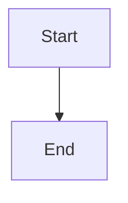

# Revision-bound architecture proposals and recoverable acceptance

## Parent Epic

epic_034

## Scope

Delivery slice C of epic_034; success criteria 4, 6, 10–11 and accepted-baseline portion of 15.

Deliver the review-unit contract from the epic: owner and repository identities, fixed documentation destination, exact plan/design/model revisions and pinned source closure, accepted baseline, requirement/decision/view citations, architecture impact, and explicit no-diagram-change or empty-baseline state. Stage proposals before approval/dispatch without advancing accepted architecture. Artifact edits invalidate affected review; stale baselines require rebase/re-review. Claimed diagram changes with missing/invalid models cannot pass.

Ship minimum authorized owner-scoped read/stage/review paths WITH these gates; do not wait for F to make required proposals authorable. Enable gates explicitly and by version: preserve recorded rollout for already executing work; new/materially revised proposals bind reviewed artifacts. No rollout exception permits a claimed missing model.

Accept code and documentation together where possible. For split repositories, journal the exact approved revision tuple and expected heads before merging implementation into its owned integration lineage, then exact reviewed docs; only both accepted sides advance the architecture pointer and completion. A partial merge remains acceptance_pending and holds affected downstream work. Retry only the missing operation; recognize landed ancestry after crashes. Scope pointers by integration lineage; use lifecycle reservation/generation checks before and after Git work so competing promotions cannot overwrite newer acceptance. No lock held across rendering/remote Git.

Acceptance: mutation of every reviewed artifact, stale baseline, minimum authoring under enabled gates, split failure/retry and conflicts, destination changes, competing promotion, and accepted child baseline without advancing trunk. Include integration checks and documentation closeout.

## Data structures

TBD.

## API contracts

TBD.

## Logic flow

## Task breakdown

_(empty — Feature Team mints tasks after dispatch)_

## Risks & upward questions

None.

## Decision log

None yet.
