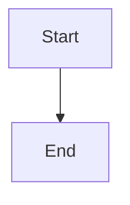

# Paired C4 review and semantic comment threads

## Parent Epic

epic_034

## Scope

Delivery slice D of epic_034; success criteria 7–10.

Extend the existing plan viewer with current/proposed diagrams for the same view/level, labeled by repository and pinned revision, adjacent to proposal text even across repositories. One synchronized state owns view/level, selected semantic target, and navigation history. Selecting elements OR relationships in either side highlights the counterpart; drill, view switching, and back navigation stay synchronized. Added/removed targets remain on their side with explicit absent counterparts. All changed views are reachable; include semantic change legend/summary, requirements/decisions, and source/model/plan diffs. Use B's proven semantic bindings; failures show an error/source diff, never a false match or static-only substitute.

Reuse existing review threads with requirement, view, element, and relationship anchors: semantic ID/key, current/proposed side, source repository, revision. Keep anchors distinct from heading slugs. Preserve threads/diff paths after changes; removed/renamed targets are outdated and blocking threads remain blocking until an authorized human resolves them.

Enforce blocking scope at approval and affected downstream mint/dispatch/integration/merge/closure boundaries using ownership/citations and explicit affected IDs/dependents. If narrower scope cannot be established, visibly hold the owner's subtree rather than unrelated epics.

Acceptance: browser scenarios for paired element/relationship focus, both-way navigation, all changed views, absent/empty/error states; all four anchors, outdated targets, exact revision gates and scoped blocking. No freehand/pixel annotation or general diagram editor. Include documentation closeout.

## Data structures

TBD.

## API contracts

TBD.

## Logic flow

## Task breakdown

_(empty — Feature Team mints tasks after dispatch)_

## Risks & upward questions

None.

## Decision log

None yet.
