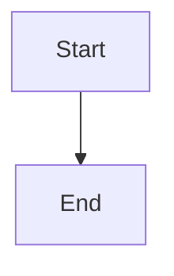

# Living epic revisions and accountable change-request routing

## Parent Epic

epic_034

## Scope

Delivery slice E of epic_034; success criteria 15–18.

Route an active feature comment once to its live Feature Team; route backlog/unstaffed feature comments under an active epic to the Epic Team with full feature/comment context. Durable accountable handoff identity includes originating comment, feature, affected work, and receiving owner. After any sibling has merged, material feature-plan requests require Epic impact triage even if apparently local; also escalate epic-contract, sibling, accepted-work, and sequencing impact.

Record the Epic decision and reply/relay it in the originating thread. Choose amendment of still-open work, an epic/feature contract amendment, a separately reviewed corrective feature with dependencies on accepted work, or a visible blocker requiring a human replacement/replanning decision. Never automatically return the epic to backlog or reset accepted work.

Preserve completed feature IDs, commits, review history, decisions, and accepted architecture. Later proposal current state uses the latest accepted epic integration architecture. Changed work gets fresh revision-bound review and human approval; prior epic approval does not silently cover corrective features.

Hold only affected minting/dispatch/task integration/feature merge/closure at safe boundaries while material requests remain unresolved. Preserve active task branches and work; held results cannot integrate. Unrelated accepted siblings remain accepted.

Acceptance: one merged sibling plus changed active/backlog feature; one accountable escalation and originating-thread outcome; active tasks held then resumed only after authorized revised review; corrective feature separately approved; unsafe restart visibly blocked. Include integration coverage and documentation closeout.

## Data structures

TBD.

## API contracts

TBD.

## Logic flow

## Task breakdown

_(empty — Feature Team mints tasks after dispatch)_

## Risks & upward questions

None.

## Decision log

None yet.
