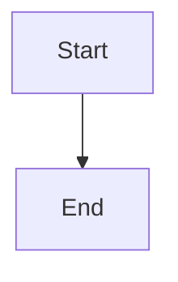

# Scoped design authoring and closure reconciliation

## Parent Epic

epic_034

## Scope

Delivery slice F of epic_034; success criteria 5 and 12. Extend C's already available minimum proposal-authoring path.

Supply epic/feature/task planning context with pinned owned/ancestor designs and model fragments. Scope read, proposal, and update capabilities to owned requirements and fragments. Parent summaries/shared fragments use owning-team amendments, including feature-to-epic architecture changes and Task closeout proposals. Grant bounded historical replay access to completed non-cancelled records and associated Git/review evidence; do not expose arbitrary other-team plans or repository files.

At Task, Feature, and Epic closure inspect implemented change against affected directory designs, ancestor summaries, and C4 views. Provide authorized staging/review/merge of necessary documentation/DSL edits. Record inspected implementation and design/model revisions, affected designs/ancestors, and an accepted update or short justified no-change result. Material mismatches block closure; split-repository acceptance_pending cannot satisfy a receipt.

Acceptance: owned authoring and pinned context at all tiers; denied cross-owner writes and proper shared/ancestor amendment routing; bounded replay reads; code-only/no-diagram-change receipt; mismatch block then accepted update; split-promotion closure hold. Reuse current tools and lifecycle gates. Coordinate shared-file ownership with E; both may proceed after dependencies. Include integration checks and documentation closeout.

## Data structures

TBD.

## API contracts

TBD.

## Logic flow

## Task breakdown

_(empty — Feature Team mints tasks after dispatch)_

## Risks & upward questions

None.

## Decision log

None yet.
