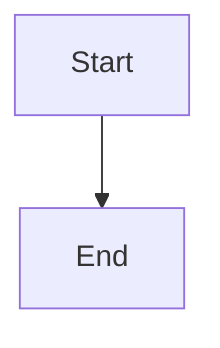

# Historical design reconstruction and final validation

## Parent Epic

epic_034

## Scope

Delivery slice G of epic_034; success criteria 13–14 and final end-to-end acceptance. Implements human cmt_001 / dec_001.

Pin an inventory of every completed, non-cancelled epic, feature, and task plus reachable target Git history at an agreed current baseline. Reconcile uncovered fixes/direct commits, merges, and available squash/rebase provenance; retrieve linked MR/PR descriptions through authorized forge access. Deduplicate overlapping work-item and commit evidence; do not assume one review per commit. Narratives are leads: validate every current design claim against code/tests. Explicitly ledger unavailable review descriptions, ambiguous provenance, unreachable/deleted history, and unresolved coverage.

Assign one editing owner per meaningful directory/shared fragment. Populate concise designs and initial C4 model in the configured destination; reconcile leaves to root, then downward/across interfaces. Preserve root design, one-home requirements and decisions, stable model IDs, and accepted proposal/closeout workflow. Cancelled plans are not requirements sources, while surviving code remains subject to actual-code/history checks. Every excluded target directory names its covering parent.

The replay ledger accounts for each completed work item and uncovered commit, review references, evidence revisions, affected requirement/decision IDs, and durable/superseded/no-impact/unresolved outcome. Before closeout reconcile accepted work since the inventory pin.

Validate parent-child consistency, cross-directory interfaces, references, view links, TOC headings, real pinned DSL/JSON/SVG processing, and claims against current code/tests. Surface unresolved material gaps. Exercise direct fix, MR-described non-Cascade change, overlap, superseded/cancelled work, and unavailable provenance, plus final paired-review/split-acceptance/living-epic scenarios. Prior slices own their own integration checks; G is final reconciliation, not a deferred test bucket.

## Data structures

TBD.

## API contracts

TBD.

## Logic flow

## Task breakdown

_(empty — Feature Team mints tasks after dispatch)_

## Risks & upward questions

None.

## Decision log

None yet.
