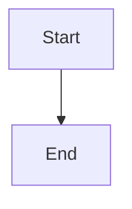

# Reconcile historical evidence and accepted architecture gaps

## Parent Epic

epic_034

## Scope

Corrective slice for epic criteria 12–14 after Feature G's canonical completion. Preserve all completed work and reuse G's inventory, reconstruction, ledger, tests and honest gap report; do not repeat A–G implementation. Requires its own reviewed plan and human approval under criterion 17; the original epic approval does not authorize execution.

Acceptance:
1. Pin separately the accepted Epic target/tracking revisions and G source artifacts. Reconcile all later accepted deltas, including F PR #218 merge d2ed1aca (present in epic f83f536a) and eventual G integration. No feature-source reachability may stand in for accepted Epic reachability.
2. Obtain the 34 A–F child-record revisions and relevant intent/verification evidence through the authorized owning Feature Teams and Epic handoff. Never use parent revisions as child revisions or filesystem access to bypass board authorization. Preserve exact unavailable reasons where retrieval fails.
3. Retrieve linked MR/PR descriptions and source revisions through existing authorized forge access, verifying linkage to reachable commits. Review URLs and merge messages are leads, not fabricated descriptions. Include non-Cascade fixes and deduplicate many-to-many work/commit/review evidence.
4. Individually reconcile the 2023 existing replay rows and accepted deltas to durable, superseded, no-impact, or unresolved dispositions with exact evidence and current-code/test references. Group work only when each row remains accounted for; do not blanket relabel missing evidence no-impact. Explain remaining evidence limitations and their materiality. Material unresolved rows prevent clean closure.
5. Reconcile affected leaf/root DESIGN files and stable-ID C4 fragments through existing owner-scoped staging/amendment paths. Complete exact-revision architecture review and accepted promotion; record current Task/Feature/Epic reconciliation receipts where required. Historical missing receipts remain honest gaps and must not be fabricated retroactively.
6. Refresh final reports and validate parent/child consistency, ownership, links, current code claims, and the pinned offline DSL/JSON/SVG pipeline. Exercise meaningful direct-fix and MR-described-change evidence plus unavailable provenance and acceptance rejection; reuse passing existing checks. Clean closeout requires no unresolved material mismatches and valid exact-revision acceptance evidence.

Planning constraints: provide concrete pinned handoff/ledger/delta/receipt contracts before task implementation. Use a small sequence of evidence acquisition, ledger/design reconciliation, and final accepted-state verification. Any proven lifecycle defect needs explicit scoped repair work, not raw state mutation. If authorized evidence remains unobtainable, report the exact prerequisite and request a human scope decision rather than silently relaxing the epic. G final-validation-report.json at 0bfcaca1 is the starting gap evidence (50 reported passing tests; clean_closeout=false).

## Data structures

TBD.

## API contracts

TBD.

## Logic flow

## Task breakdown

_(empty — Feature Team mints tasks after dispatch)_

## Risks & upward questions

None.

## Decision log

None yet.
