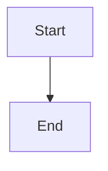

# Reconcile completed review recovery admissions in health audits

## Parent Epic

epic_034

## Scope

# Reconcile completed review recovery admissions in health audits

## Parent Epic

epic_034

## Scope

Repair the proven audit projection defect from investigation_90d4c50f3e8326ebc96bc0186bbb96a5. Preserve completed Feature F and its merged PR #218. This is a narrow orchestration repair, separate from Feature H's historical evidence and architecture acceptance work. Requires independent review and fresh human approval under epic criteria 17–18 before implementation; the old epic approval does not authorize this corrective feature.

Observed evidence: resolution:v1:e58059ef6a24760191f4653a01e6bf7ebd50260509f8edc865db5067158754ac remains status=mutation_ready in resolution_actions.json, while the same action in executions.json has recovery_state=completed and completion_reconciliation.reason=review_health_restored at 2026-11-10T02:17:15Z. reviews.json marks Feature F closed. GitHub PR #218 is MERGED at d2ed1aca886e61d087fa29842ebca617c0956d96 (2026-11-10T03:35:20Z); Feature F's 47342fb3 is reachable from the owned epic. Main's cascade/watchdog/audit.py _collect_resolution_review_references attributes the nonterminal admission to Feature F without joining authoritative action completion. _reconcile_completed_review in cascade/review_health.py completes the execution recovery but leaves the admission record unchanged.

Acceptance:
1. Reproduce the closed/merged review plus mutation_ready admission plus completed matching recovery case using actual persisted-store shapes. Confirm no unresolved recovery incident remains solely because the historical admission is retained.
2. Use exact action identity and authoritative completion evidence. A closed review alone, unrelated completed action, mismatched identity, unreadable store, or still-live/failed recovery must not suppress a real incident. Preserve audit history and fail visibly on ambiguous evidence.
3. Implement the smallest canonical reconciliation or read-only projection correction; no raw production state edits, review reopening, retry of completed children, or deletion of historical receipts. Keep repeated audit passes idempotent.
4. Add focused integration coverage for the stale admission and live/failed/mismatched/unavailable countercases. Retain existing review identity and nested-handoff regression coverage from main c0c1a891; do not regress or duplicate that already-landed repair.
5. SWE implementation occurs in its isolated task worktree and publishes a canonical review with exact test results. After accepted integration, request fresh authoritative reassessment of the assigned audit case. Repair enqueue or a successful planning turn is not proof of recovery.

## Data structures

Reuse resolution_actions.json admission identity, executions.json action recovery and completion_reconciliation, and reviews.json owner/review identities. No new store or broad schema migration. Bind authoritative completion to the exact admission action_id and owning review/work identity; retain historical evidence.

## API contracts

Reuse the existing audit observation and review-health reconciliation paths. Select either canonical admission reconciliation or a read-only join after checking current main implementation. Do not hide all references for completed features or closed reviews. Store-read failures remain unavailable evidence, not healthy status.

## Logic flow

Read scoped admission and recovery evidence; bind exact action identity; validate terminal reconciliation and owner identity; project the resolved historical action without reviving it; preserve genuine pending references; request independent reassessment after accepted repair.

## Task breakdown

One focused SWE repair and regression-validation slice, followed by normal independent review. Do not dispatch before the new feature's review and human approval.

## Risks & upward questions

The audit source in the epic checkout predates main c0c1a891. Use the current deployed audit behavior for reproduction and retain its identity fixes. Feature H remains separately responsible for unresolved historical and architecture acceptance evidence; this repair cannot declare the epic accepted.

## Decision log

None yet.

## Data structures

TBD.

## API contracts

TBD.

## Logic flow

## Task breakdown

_(empty — Feature Team mints tasks after dispatch)_

## Risks & upward questions

None.

## Decision log

None yet.
