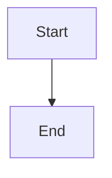

# Admit and route review-conflict resolution actions

## Parent Epic

epic_035

## Scope

## Objective

Unify explicit operator requests and epic_031 recovery requests under one durable resolution-action identity. Resolve the open review, refs, observed source SHA, worktree, and owning team; provide scoped read-only inspection; and persist actionable rejection/blocker state.

## Required outcomes

- One request contract and idempotency key covers both entry paths.
- Feature-owned reviews route to their Feature Team; Epic-owned and explicitly assigned child reviews route to the Epic Team.
- Cross-feature ambiguity selects one accountable owner or blocks.
- Closed reviews, unauthorized refs, stale heads, dirty unrelated files, missing metadata, credentials, or permissions do not reach mutation.
- War Room state identifies the failed checkpoint, observed refs/SHAs, affected paths, and a concrete resume action.
- High-signal tests cover routing, authorization, duplicate admission, and rejection boundaries.

## Non-goals

No rebase, conflict edit, force-with-lease push, general shell, or lifecycle-gate bypass in this feature.

## Data structures

TBD.

## API contracts

TBD.

## Logic flow

## Task breakdown

_(empty — Feature Team mints tasks after dispatch)_

## Risks & upward questions

None.

## Decision log

None yet.
