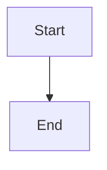

# Execute and publish an owned review rebase

## Parent Epic

epic_035

## Scope

## Objective

Run an admitted resolution action in a dedicated repository-backed team turn and safely update the same open review source branch.

## Required outcomes

- The turn receives only the authorized review/worktree, linked Git metadata, minimal edit/test operations, and push credentials.
- It records worktree state and source/target remote SHAs, fetches, and revalidates authorization and heads before mutation.
- It rebases the owned source onto the target, permits edits only to conflicted/owned paths, and blocks unresolved semantic ambiguity.
- It runs repository-defined relevant checks and captures results.
- It re-reads the remote source and pushes only with an explicit `--force-with-lease=<source-ref>:<observed-sha>`.
- Lease races, failed tests, dirty unrelated paths, or changed authorization stop without discarding user work.
- An end-to-end fixture exercises one semantic conflict and one clean rebase.

## Non-goals

No target/trunk rewrite, new review creation, review replacement, unrestricted shell, automatic product decisions, or bypass of existing lifecycle/review gates.

## Data structures

TBD.

## API contracts

TBD.

## Logic flow

## Task breakdown

_(empty — Feature Team mints tasks after dispatch)_

## Risks & upward questions

None.

## Decision log

None yet.
