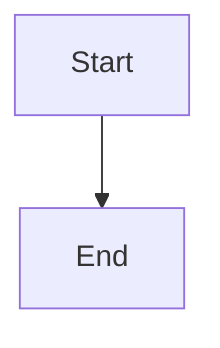

# Make conflict resolution restart-safe across providers

## Parent Epic

epic_035

## Scope

## Objective

Harden the admitted rebase workflow so interruption, retries, and provider differences cannot duplicate or misreport side effects.

## Required outcomes

- A restarted action reconciles durable action state, local rebase/worktree state, and current remote head before choosing resume, safe retry, completed reconciliation, or blocker.
- Commits, pushes, reviews, War Room completion messages, and lifecycle completion events are emitted at most once per action identity.
- Every supported Feature/Epic Team provider launches and reports the same capability/result contract.
- Blockers preserve checkpoint, refs/SHAs, affected paths, test/command summary, and resume instructions.
- Acceptance validates the PR #147-style `action_recovery.py` semantic conflict and PR #148-style clean rebase, plus interruption and remote-head-race cases.

## Non-goals

No expansion to arbitrary branch maintenance, unrelated repositories, autonomous cross-feature product choices, or redundant broad unit-test coverage.

## Data structures

TBD.

## API contracts

TBD.

## Logic flow

## Task breakdown

_(empty — Feature Team mints tasks after dispatch)_

## Risks & upward questions

None.

## Decision log

None yet.
