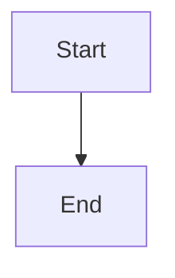

# Resolve the optional tracking repository

## Parent Epic

epic_036

## Scope

## Intent

Establish the repository-role model and optional tracking-repository configuration without changing default behavior.

## Acceptance criteria

- TOML and YAML accept one equivalent optional tracking-repository reference.
- Omission aliases tracking to target and preserves existing compatibility behavior.
- Local references resolve relative to the config location; remote references resolve to a deterministic managed checkout.
- Existing checkouts and clone preparation are validated idempotently.
- Git uses existing user configuration and credentials; Cascade does not prompt for or store credentials.
- Invalid paths, unsupported references, clone failures, and authentication failures produce actionable, redacted diagnostics.
- Resolved target and tracking contexts are explicit for downstream services.

## Scope constraints

Honor the epic contract and non-goals. Exact config-key naming, managed-checkout location, and synchronization mechanics may be selected here.

## Data structures

TBD.

## API contracts

TBD.

## Logic flow

## Task breakdown

_(empty — Feature Team mints tasks after dispatch)_

## Risks & upward questions

None.

## Decision log

None yet.
