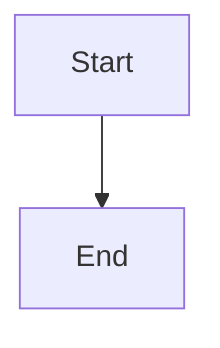

# Route planning lifecycle through the tracking repository

## Parent Epic

epic_036

## Scope

## Intent

Route the complete planning lifecycle through the resolved tracking repository while source work remains in the target repository.

## Acceptance criteria

- Epic, feature, and task create/read/update/list flows, decision history, and required versioned lifecycle metadata use the tracking repository.
- Source changes and implementation worktrees continue to use only the target repository.
- A split-mode end-to-end scenario advances planning artifacts in the tracking repository while leaving the target repository free of those artifact changes.
- A colocated end-to-end scenario proves unchanged default behavior.
- Failure coverage handles unavailable tracking storage and failed Git synchronization without false success reporting.
- Documentation covers configuration, local and remote references, preconfigured Git/SSH access, adoption of existing artifacts, and recovery from interrupted preparation or synchronization.

## Dependency

Depends on feat_036_001 for repository-role resolution and configuration.

## Scope constraints

Honor the epic contract and non-goals. Do not add automatic migration, credential management, cross-repository transactions, or general multi-repository source orchestration.

## Data structures

TBD.

## API contracts

TBD.

## Logic flow

## Task breakdown

_(empty — Feature Team mints tasks after dispatch)_

## Risks & upward questions

None.

## Decision log

None yet.
