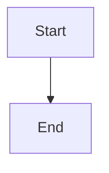

# Expose actionable War Room diagnostics and readiness

## Parent Epic

epic_037

## Scope

Complete epic_037 success criteria 3, 4, 6 and 10 using the shared evaluator, gates and recovery action. Extend the existing provider recovery dialog, API serialization and board rows.

Acceptance:
- Epic activation, Feature dispatch, approval-driven dispatch and Task retry display a focused accessible failure dialog/panel with every affected role, provider/model/reasoning/Flex selection, safe reason, configuration path/revision, inventory freshness and valid remedies. Lead with readable failure text; provider_preflight_blocked is never sole feedback. Make partial approval/dispatch outcomes explicit.
- Render server-computed action eligibility: refresh/retry for transient state, provider setup, a usable path to change configuration, and Continue without Flex only when eligible. Changes still flow through existing review/recovery paths. A stale view cannot grant authority; command-side checks decide.
- Backlog and active rows display configuration readiness separately from lifecycle/dependency/plan readiness. Derive all results from the same evaluator, sharing the bounded inventory cache across rows. Display stale/unknown state explicitly; no provider discovery on every row and no model turn for a readiness refresh.
- Refreshing inventory reprojects readiness and dialog diagnostics without lifecycle events, queue/checkpoint mutation or new incidents. A cached success cannot clear a durable blocker. Preserve visible failure/context on unsuccessful action; show completion once for idempotent success.
- Reuse keyboard/focus handling and labels in the existing dialog, including safe text rendering and focus restoration.

Validation: add economical browser/API flows using the repository's existing browser harness and fake provider inventory: invalid future Feature/SWE role at activation; all failed roles/remedies; one successful Continue without Flex retry with unchanged reviewed plan; transient/setup flow distinct from deterministic selection rejection; stale inventory refreshed; catalog drift after activation blocked at launch; approval-driven failures and Task retry. Assert lifecycle side-effect counts on the server and keyboard/focus behavior in the browser. Run targeted existing recovery/readiness/brief/approval regression suites; no dependency installation is authorized.
Implementation anchors: cascade/war_room/serialize.py, provider routes and dispatch/approval handlers, cascade/war_room/static/provider_recovery_dialog_ui.js, war_room.js and board row presentation; tests/war_room existing browser flow harness.

## Data structures

TBD.

## API contracts

TBD.

## Logic flow

## Task breakdown

_(empty — Feature Team mints tasks after dispatch)_

## Risks & upward questions

None.

## Decision log

None yet.
