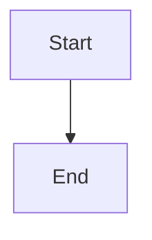

# Expose authoritative dependency status to planning

## Parent Epic

epic_038

## Scope

# Expose authoritative dependency status to planning

## Intent

Give epic and feature planners a minimal, read-only view of every declared dependency without granting access to its specification.

## Scope and contract

- Reuse the canonical tracking-root and merged-board resolution and lifecycle completion rules. Extract a shared evaluator where existing checks are duplicated; do not introduce a second status store.
- For each declared dependency return work ID, tier when known, canonical status and column when known, outcome (`satisfied`, `dependency_unmet`, or `dependency_status_unavailable`), safe completion evidence, and stable reason when unavailable. Carry observation time and an opaque authoritative revision/fingerprint so a snapshot is clearly identifiable, not an authorization token.
- Known incomplete, cancelled, or status/column mismatch is unmet. An absent ID in an otherwise valid authoritative board is unavailable with `dependency_not_found`; inability to establish the authoritative source is unavailable with a stable source-failure reason. Empty dependency lists are satisfied.
- Complete means canonical `completed` in `3_completed`; existing review/stacked-dispatch restrictions remain explicit action checks and are not silently removed or redefined.
- Inject the projection into every epic/feature planning turn. Expose a scope-bound read-only refresh through the existing planning tool registration/MCP transport; derive the allowed dependency IDs from the caller's current owning spec, not arbitrary IDs or paths.
- Keep scoped document authorization and sandbox allowlists unchanged. A denied content read is `content_access_denied`, independent of dependency outcome. Never include bodies, comments, prompts, raw paths, exception text, or secrets in the projection.

## Acceptance criteria

1. Completed but unreadable dependencies are satisfied for both planning tiers; readable incomplete dependencies are unmet.
2. Missing/source-unavailable cases are distinguishable and fail closed; tracking-repository ownership and completed trunk precedence are respected over stale worktree copies.
3. All declared IDs are represented; no-dependency work remains ready on this dimension.
4. Read-only refresh cannot enumerate arbitrary board items; existing cross-team content reads remain denied.
5. Completion evidence is derived from the authoritative state, never from read access or transcript text.

## Validation

Extend existing board/tracking, planning sandbox/tool, and dispatch tests with focused integration cases. Include small predicate tests only for distinctions not already exercised. Before implementation, document the existing review/stacked behavior and cache/snapshot semantics to preserve; pin them in focused compatibility tests.

## Exclusions

No new dependency database, dependency graph validation feature, permission broadening, or historical transcript rewrite.

## Data structures

TBD.

## API contracts

TBD.

## Logic flow

## Task breakdown

_(empty — Feature Team mints tasks after dispatch)_

## Risks & upward questions

None.

## Decision log

None yet.
