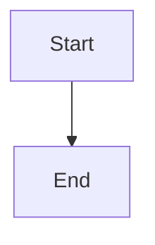

# Recheck dependency status at planning action boundaries

## Parent Epic

epic_038

## Scope

# Recheck dependency status at planning action boundaries

## Intent

Prevent a stale planning snapshot from approving or authorizing downstream work while allowing an active dependent plan to observe newly completed dependencies.

## Scope

Consume the shared evaluator and scope-bound status contract from feat_038_001 in plan readiness, role sign-off, plan/feature approval, activation/dispatch dependency checks, and feature minting guidance and mutation boundaries. Preserve all existing non-dependency authorization, plan revision, review, and stacked-dispatch checks.

## Acceptance criteria

1. Re-read the owning work item's current declared dependencies and authoritative lifecycle evidence immediately before sign-off, approval, or minting authorization. Do not reuse the turn-start snapshot or a request-scoped/cached board view as proof of freshness.
2. Use the existing action/lifecycle synchronization boundary (or a minimal revision-checked retry/refusal where required) so a concurrent dependency change cannot commit an action based on superseded evidence. A failed refresh returns `dependency_status_unavailable` and performs no authorization-dependent mutation.
3. Known unmet prerequisites return `dependency_unmet`; a denied plan-body read never becomes a dependency blocker. Dependency evidence is evaluated separately from plan revision sign-offs; unchanged plan text does not make old dependency evidence current.
4. An incomplete dependency that completes during the active epic's planning is recognized on the next refresh/action without restarting or reactivating the epic. The inverse transition or source loss before action fails closed.
5. Boundary checks concern the owning work item's execution prerequisites. Creating a backlog child may declare existing but incomplete predecessor features; do not require the new child's predecessors to be completed merely to describe and sequence future work. Preserve existing tier/existence validation for those declarations.
6. Epic-plan approval checks the owning epic's current prerequisites before its existing bulk approval of backlog children. Unfinished valid sibling predecessors do not block that bulk plan approval. Bulk child approval records do not certify execution readiness: each child's activation/dispatch rechecks its own prerequisites. Direct feature sign-off/approval checks that feature's prerequisites. Refuse an epic with unmet/unavailable prerequisites before writing any bulk child approval.
7. Approval/readiness and dispatch use the shared lifecycle result; existing review/stacked restrictions remain separately reported and enforced. Existing approval records, role-specific sign-off semantics, and ordinary no-dependency workflows remain compatible.

## Validation

Extend existing sign-off, plan-readiness, minting, approval/dispatch, and lifecycle integration tests. Drive incomplete-to-completed and satisfied-to-unmet/unavailable transitions between turn context creation and the action, including a preloaded board cache/request snapshot. Verify refusal leaves no new approval, sign-off, or child artifact. Include successful sequential minting and bulk epic-plan approval with unfinished sibling predecessors, then verify approved successors remain undispatchable until their own prerequisites complete. Verify an epic prerequisite failure leaves every child approval unchanged.

## Exclusions

No redesign of approval policy, scheduling, stacked PRs, dependency graph validation, or automatic activation of downstream work.

## Data structures

TBD.

## API contracts

TBD.

## Logic flow

## Task breakdown

_(empty — Feature Team mints tasks after dispatch)_

## Risks & upward questions

None.

## Decision log

None yet.
