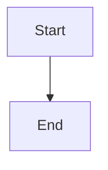

# Align dependency reporting and lock end-to-end regressions

## Parent Epic

epic_038

## Scope

# Align dependency reporting and lock end-to-end regressions

## Intent

Make current dependency explanations agree across planning context, readiness, minting guidance, War Room, and generated transcript summaries without presenting old chat as current authority.

## Scope

Consume the shared projection and action results from feat_038_001/002 in existing operator-facing surfaces. Keep machine-readable outcomes/reasons separate from human explanations. Do not infer dependency state from arbitrary agent prose or document-access exceptions.

## Acceptance criteria

1. For the same authoritative snapshot, planning context, plan readiness, feature minting guidance, War Room live status, and generated current summaries agree on dependency outcomes. Existing unrelated readiness/review blockers remain visible and distinct.
2. `content_access_denied`, `dependency_unmet`, and `dependency_status_unavailable` have separate representations and explanations. The system never manufactures an unmet dependency from a denied content read.
3. Preserve historical transcript messages verbatim as dated history. Clearly distinguish their observed-at status from a current structured dependency summary; legacy messages lacking evidence are not treated as live dependency assertions. Refresh current status through the normal board/readiness path, not chat parsing or a new polling service.
4. When a dependency completes while its dependent epic remains active, the next normal live refresh and next action show satisfaction. A prior transcript's blocker neither persists as a live blocker nor needs rewriting.
5. Capture the epic_034/epic_036 sequence in a synthetic integration fixture: epic_034 depends on epic_036; canonical epic_036 completion wins over a stale active copy; epic_034 still cannot read epic_036's spec; planning and action results report satisfied. Do not depend on production board data or private plan content.
6. End-to-end coverage includes completed/unreadable, readable/incomplete, missing dependency, authoritative-source failure, tracking-repository dependency, mid-turn completion, and stale-success refusal at an action boundary. Include unchanged scoped authorization and existing review/stacked behavior.

## Validation and release evidence

Extend existing War Room readiness/board/transcript and lifecycle suites; reuse the board fixtures and API-level tests from preceding features. Use one UI-level assertion where needed to prove current-vs-historical labeling. Avoid redundant per-helper tests and a new test framework. Provide a requirement-to-test mapping for epic success criteria 1–8 and record the relevant suite results before epic acceptance.

## Exclusions

No transcript migration, chat rewriting, dashboard redesign, live push infrastructure, additional dependency database, or new graph-validation policy.

## Data structures

TBD.

## API contracts

TBD.

## Logic flow

## Task breakdown
- task_038_003_004
- task_038_003_003
- task_038_003_002
- task_038_003_001

_(empty — Feature Team mints tasks after dispatch)_

## Risks & upward questions

None.

## Decision log

None yet.

## Closeout

Completed child work: `task_038_003_001` (Align planning and action dependency explanations), `task_038_003_002` (Align War Room live status and transcript summaries), `task_038_003_003` (Add synthetic dependency lifecycle regressions), `task_038_003_004` (Record requirement coverage and release evidence).
