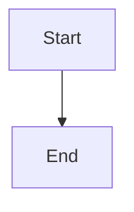

# Dependency manifests, evidence, and planning gates

## Parent Epic

epic_039

## Scope

Implement slice A of epic_039. Add durable revisioned dependency manifests (including explicit none required), append-only check attempts tied to actual environment identity, and immutable evidence snapshots bound to planning sign-off. Enforce current readiness at ordinary feature mint, sign-off, and plan approval using existing lifecycle/tracking-repository primitives. Missing, stale, unknown-environment, or unresolved-feasibility evidence blocks. Invalidate only affected dependency authority; preserve existing whole-plan revision sign-off rules. Existing epics require a manifest at their next planning action without restarting or cancelling accepted work. Keep software dependencies distinct from work-item depends_on. Acceptance: integration tests for absent/empty manifests, matching/mismatching environments, stale attempt completion and revisions, selective invalidation, and all guarded entry points. Define schemas and public transition contracts needed by slice B. No installation runner or new work-item tier in this slice.

## Data structures

TBD.

## API contracts

TBD.

## Logic flow

## Task breakdown

_(empty — Feature Team mints tasks after dispatch)_

## Risks & upward questions

None.

## Decision log

None yet.
