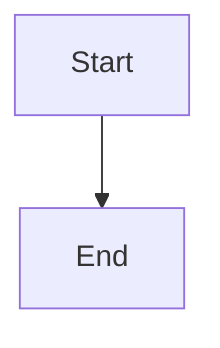

# Dependency manifests, evidence, and planning gates

## Parent Epic

epic_039

## Scope

Implement slice A of epic_039. Add durable revisioned dependency manifests (including explicit none required), append-only check attempts tied to actual environment identity, and immutable evidence snapshots bound to planning sign-off. Enforce current readiness at ordinary feature mint, sign-off, and plan approval using existing lifecycle/tracking-repository primitives. Missing, stale, unknown-environment, or unresolved-feasibility evidence blocks. Invalidate only affected dependency authority; preserve existing whole-plan revision sign-off rules. Existing epics require a manifest at their next planning action without restarting or cancelling accepted work. Keep software dependencies distinct from work-item depends_on. Acceptance: integration tests for absent/empty manifests, matching/mismatching environments, stale attempt completion and revisions, selective invalidation, and all guarded entry points. Define schemas and public transition contracts needed by slice B. No installation runner or new work-item tier in this slice.

### Per-dependency installation authority

Every dependency installation or upgrade requires explicit human approval bound to dependency ID, exact version, authoritative source, checksum/digest, target environment, install scope/destination, exact operation, and cleanup plan. Persist an independent approval for each entry with human provenance and the reviewed binding. Epic/feature plan approval and bootstrap review alone grant no installation authority. Provider `yolo` and owned-worktree access provide execution capability only. Cascade must enforce the approval at the operation boundary before mutation, independently of the provider sandbox and in addition to current execution policy.

A batch UI may approve several entries in one interaction only if it persists independent per-entry approvals. Any change to dependency ID, version, source, digest, environment, scope/destination, operation, or cleanup plan invalidates only that entry's approval; unchanged entries retain theirs. Read-only discovery and validation may proceed without installation approval. Checks that install, upgrade, or implicitly pull dependencies must pass the installation gate. Plan sign-offs, resume/ping, and successful checks never create installation approval.

Define canonical approval records and public validity/invalidation contracts for slice B: exact binding, approver identity/time, reviewed entry snapshot/revision, and attempt-to-approval references. Keep installation approvals distinct from plan sign-off, readiness evidence, and feasibility authorization. Whole-manifest revision changes do not revoke approvals whose bound fields are unchanged; verification-recipe changes invalidate affected evidence. Acceptance must cover every binding field, independent approvals from one batch, unchanged-entry survival, and plan approval producing no installation authority. Preserve existing integration tests and the no-installation-runner boundary of this slice.

## Data structures

TBD.

## API contracts

TBD.

## Logic flow

## Task breakdown

_(empty — Feature Team mints tasks after dispatch)_

## Risks & upward questions

None.

## Decision log

None yet.
