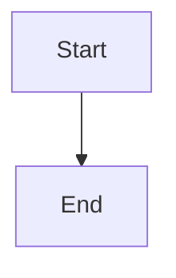

# Authorized bootstrap and resumable dependency checks

## Parent Epic

epic_039

## Scope

Implement slice B of epic_039 on feat_039_001 contracts. Introduce an epic-owned feature-zero bootstrap record (not an ordinary feature or tier), narrow human-reviewed feasibility scope, independent per-entry human installation approvals, current-policy checks, and bounded environment-specific verification/setup. Scope binds exact pinned operations, sources and integrity, paths, feasibility artifacts, limits, cleanup, and authorization provenance. No silent sudo/system-default changes, credentials, license acceptance, publishing, or latest references. Model unchecked, awaiting_authorization, checking, dependency_blocked, and ready; installation success must not imply adapter feasibility. Persist actionable human guidance. Route human ping/resume through existing run/recovery with deduplication, locked admission and result recheck, partial-state reconciliation, bounded retries, and append-only attempts. Never treat ping as proof or installation authorization. Acceptance: integration coverage for permitted local/container setup, denied system mutation, offline source, checksum mismatch, license/credential prompt, wrong environment, stale result, duplicate ping, partial setup and restart, human install/recheck, circular feasibility gate, and no-dependency path. Include real harmless project-local and pinned-container smoke evidence in an authorized environment. For the approved epic_034 Structurizr scenario, record actual host Java incompatibility, authoritative chosen distribution and immutable container digest, bundled runtime and in-container check, and a separate authorized adapter-feasibility result. Do not build epic_034's production adapter. Unavailable real smoke environment remains an explicit acceptance blocker.

### Per-dependency installation authority

Every dependency installation or upgrade requires explicit human approval bound to dependency ID, exact version, authoritative source, checksum/digest, target environment, install scope/destination, exact operation, and cleanup plan. Persist an independent approval for each entry with human provenance and the reviewed binding. Epic/feature plan approval and bootstrap review alone grant no installation authority. Provider `yolo` and owned-worktree access provide execution capability only. Cascade must enforce the approval at the operation boundary before mutation, independently of the provider sandbox and in addition to current execution policy.

A batch UI may approve several entries in one interaction only if it persists independent per-entry approvals. Any change to dependency ID, version, source, digest, environment, scope/destination, operation, or cleanup plan invalidates only that entry's approval; unchanged entries retain theirs. Read-only discovery and validation may proceed without installation approval. Checks that install, upgrade, or implicitly pull dependencies must pass the installation gate. Plan sign-offs, resume/ping, and successful checks never create installation approval.

Consume slice A's independent approval records and fail closed at every Cascade dependency operation boundary, including setup, provider execution, MCP/UI entry points, and retry/resume. Validate the exact binding immediately before mutation and recheck it when accepting completion; stale queued approvals cannot authorize execution. Retain feasibility-scope authorization separately. Acceptance must demonstrate denial before any install/upgrade under `yolo`, owned-worktree access, or approved epic/feature plans when per-entry approval is missing; rejection for each changed binding field; preservation of unrelated approvals; approved execution; and read-only checks without installation approval. Real local and Structurizr/container installation acceptance requires separately recorded explicit human approval for each exact recipe, including digest and cleanup; this feature plan grants none.

## Data structures

TBD.

## API contracts

TBD.

## Logic flow

## Task breakdown

_(empty — Feature Team mints tasks after dispatch)_

## Risks & upward questions

None.

## Decision log

None yet.
