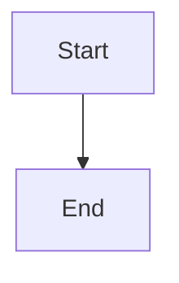

# Authorized bootstrap and resumable dependency checks

## Parent Epic

epic_039

## Scope

Implement slice B of epic_039 on feat_039_001 contracts. Introduce an epic-owned feature-zero bootstrap record (not an ordinary feature or tier), narrow human-reviewed scope, current-policy checks, and bounded environment-specific verification/setup. Scope binds exact pinned operations, sources and integrity, paths, feasibility artifacts, limits, cleanup, and authorization provenance. No silent sudo/system-default changes, credentials, license acceptance, publishing, or latest references. Model unchecked, awaiting_authorization, checking, dependency_blocked, and ready; installation success must not imply adapter feasibility. Persist actionable human guidance. Route human ping/resume through existing run/recovery with deduplication, locked admission and result recheck, partial-state reconciliation, bounded retries, and append-only attempts. Never treat ping as proof or installation authorization. Acceptance: integration coverage for permitted local/container setup, denied system mutation, offline source, checksum mismatch, license/credential prompt, wrong environment, stale result, duplicate ping, partial setup and restart, human install/recheck, circular feasibility gate, and no-dependency path. Include real harmless project-local and pinned-container smoke evidence in an authorized environment. For the approved epic_034 Structurizr scenario, record actual host Java incompatibility, authoritative chosen distribution and immutable container digest, bundled runtime and in-container check, and a separate authorized adapter-feasibility result. Do not build epic_034's production adapter. Unavailable real smoke environment remains an explicit acceptance blocker.

## Data structures

TBD.

## API contracts

TBD.

## Logic flow

## Task breakdown

_(empty — Feature Team mints tasks after dispatch)_

## Risks & upward questions

None.

## Decision log

None yet.
