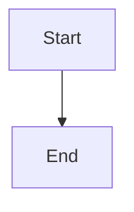

# War Room dependency review, resume, and acceptance flow

## Parent Epic

epic_039

## Scope

Implement slice C of epic_039 using feat_039_001 canonical records and feat_039_002 actions. Show bootstrap/dependency status, responsible actor, actual environment, last check, actionable failure and exact safe investigation/install guidance, expected verification output, owned-artifact cleanup, and Ping team after completion/resume. Provide narrow human bootstrap-scope review without preapproving ordinary implementation. UI and agent chat derive live state from the same canonical projection. Scope changes require relevant renewed authority; resume never asserts readiness. Reuse existing War Room routes/actions and planning-readiness controls. Acceptance: existing browser/API integration harness proves complete blocked → human action → ping → same-run recheck → planning readiness, denial/stale authorization, duplicate requests/restart, preserved accepted work, mismatch visibility, and explicit no-dependency flow. Verify all eleven epic criteria with the real local/container and Structurizr evidence produced by slice B; do not replace missing real evidence with a simulated success. No general dependency dashboard or unrelated UI redesign.

## Data structures

TBD.

## API contracts

TBD.

## Logic flow

## Task breakdown

_(empty — Feature Team mints tasks after dispatch)_

## Risks & upward questions

None.

## Decision log

None yet.
