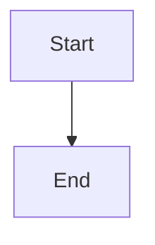

# War Room dependency review, resume, and acceptance flow

## Parent Epic

epic_039

## Scope

Implement slice C of epic_039 using feat_039_001 canonical records and feat_039_002 actions. Show bootstrap/dependency status, responsible actor, actual environment, last check, actionable failure and exact safe investigation/install guidance, expected verification output, owned-artifact cleanup, and Ping team after completion/resume. Provide narrow human bootstrap-scope review and separate per-entry installation approval without preapproving ordinary implementation. UI and agent chat derive live state from the same canonical projection. Scope changes require relevant renewed authority; resume never asserts readiness. Reuse existing War Room routes/actions and planning-readiness controls. Acceptance: existing browser/API integration harness proves complete blocked → human action → ping → same-run recheck → planning readiness, denial/stale authorization, duplicate requests/restart, preserved accepted work, mismatch visibility, and explicit no-dependency flow. Verify all eleven epic criteria with the real local/container and Structurizr evidence produced by slice B; do not replace missing real evidence with a simulated success. No general dependency dashboard or unrelated UI redesign.

### Per-dependency installation authority

Every dependency installation or upgrade requires explicit human approval bound to dependency ID, exact version, authoritative source, checksum/digest, target environment, install scope/destination, exact operation, and cleanup plan. Persist an independent approval for each entry with human provenance and the reviewed binding. Epic/feature plan approval and bootstrap review alone grant no installation authority. Provider `yolo` and owned-worktree access provide execution capability only. Cascade must enforce the approval at the operation boundary before mutation, independently of the provider sandbox and in addition to current execution policy.

A batch UI may approve several entries in one interaction only if it persists independent per-entry approvals. Any change to dependency ID, version, source, digest, environment, scope/destination, operation, or cleanup plan invalidates only that entry's approval; unchanged entries retain theirs. Read-only discovery and validation may proceed without installation approval. Checks that install, upgrade, or implicitly pull dependencies must pass the installation gate. Plan sign-offs, resume/ping, and successful checks never create installation approval.

Present the complete binding and current/missing/stale approval state for each dependency. Provide an explicit human installation/upgrade approval action separate from plan approval, bootstrap feasibility review, and resume. A batch interaction must record an independent human approval for each displayed entry; a changed entry cannot reuse another entry's approval or a blanket batch token. Use Cascade's operation gate even for direct API requests. Acceptance must show independent persisted approvals, rejection of stale submitted bindings, one changed entry requiring reapproval while unchanged batch entries remain approved, plan approval and ping granting no installation authority, and read-only discovery/validation without an installation prompt. Retain the full lifecycle and real-evidence acceptance obligations.

## Data structures

TBD.

## API contracts

TBD.

## Logic flow

## Task breakdown

_(empty — Feature Team mints tasks after dispatch)_

## Risks & upward questions

None.

## Decision log

None yet.
