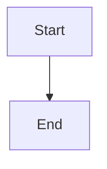

# Scoped dependency manifest authoring for Epic planners

## Parent Epic

epic_043

## Scope

Implement Feature A from epic_043: the smallest scoped declaration boundary that lets an owning active Epic planning team recover from missing_manifest using supported tools.

Acceptance criteria:
1. Expose read_dependency_manifest and write_dependency_manifest in the Epic planning registry/MCP catalog for epic_manager and epic_architect only. Enforce trusted role, Epic, and owning integration-worktree scope at runtime, including calls bypassing schema validation. No feature/task/Boss authoring authority, caller scope/root/actor overrides, unknown fields, generic sidecar permissions, completed/non-owned Epic writes, or trunk fallback.
2. Read returns the canonical snapshot and manifest revision, or explicit missing with revision 0. Write requires expected_revision as a non-negative integer (reject absent, boolean, negative, fractional, and string values). Reuse canonical dependency_manifests validation, append-only persistence, and dependency_state_lock.
3. Support explicit none_required=true with dependencies=[] and complete target environment identity, plus real canonical dependency entries. Validate raw current-schema identity keys before legacy defaults for the top-level target, each dependency target, and non-null actual_environment. Keep actual_environment=null valid and preserve independent per-entry targets. Reject malformed entries, duplicate IDs, incomplete environments, and invalid actual environments before mutation.
4. Preserve concurrency semantics: expected revision checked under the canonical lock before content equality; identical current-revision content is a no-op, stale replay fails. Return JSON-safe persisted data with manifest_revision and fresh canonical software/bootstrap and plan-readiness projections, coherent under the same re-entrant lock. Graph-only readiness is insufficient.
5. Manifest authoring requires no prior software readiness and grants no installation, upgrade, sudo, credential, license, approval, or execution authority. Preserve existing evidence/approval binding invalidation, human approval boundaries, and ordinary lifecycle gates.

Verification: extend existing production planning-dispatcher/catalog and boundary integration tests for both roles; absent/read/create/append/no-op; explicit none-required and real declarations; malformed/runtime inputs; stale/concurrent/replayed writes; completed/cross-Epic and path/symlink denial; actual owning-worktree destination and canonical lock identity, including split target/tracking repositories; fresh readiness and unchanged installation authority. Do not duplicate schema unit tests or install external software.

Scope maps to epic success criteria 1–3 and authoring/readiness safety portions of 5. Feature B owns user guidance and complete cross-surface lifecycle verification. No new dependencies, generalized editor, resolver, executor, bulk migration, or automatic backfill.

## Data structures

TBD.

## API contracts

TBD.

## Logic flow

## Task breakdown

_(empty — Feature Team mints tasks after dispatch)_

## Risks & upward questions

None.

## Decision log

None yet.
