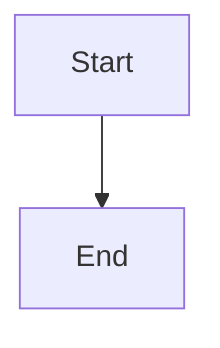

# Actionable declaration guidance and complete planning recovery

## Parent Epic

epic_043

## Scope

Implement Feature B from epic_043 after feat_043_001, using its scoped manifest read/write tools.

Acceptance criteria:
1. Use the shared canonical dependency-status projection for actionable missing_manifest guidance in brief creation/activation, War Room, and active-Epic planning prompts. Identify the owning Epic Manager or Epic Architect as the declaration author. Activation must let active owners reach the authoring step without a preexisting manifest.
2. Suppress bootstrap-review, installation-approval, and execution controls that require a manifest while it is absent. After declaration show canonical ready state or the next blocker. Explicit none-required needs no installation approval; real dependencies remain blocked until existing authenticated-human approvals and trusted verification are satisfied.
3. Preserve accepted work and the existing activation run. Prove same-run readiness refresh and restart persistence without cancellation/restart to repair the run, repeated declarations, fabricated evidence, direct Python authoring, or manual sidecars.
4. Extend the integrated production flow through supported manifest declaration, current-role evidence-bound sign-offs, ordinary authenticated human plan approval, feature mint, and existing dispatch. Cover both legacy active none-required recovery and real-dependency declaration/approval/evidence paths.
5. Make the minimal binding-preserving correction in cascade/epic/dependency_evidence.py: _require_mutation_authority currently passes entry.operation to require_installation_approval, whose contract requires InstallationBinding. Preserve the strict approval checker and intended operation policy checks; add no executor or approval route.
6. Supply an explicit supported provider-inventory fixture for normal plan approval/dispatch. The recorded baseline failed with ApprovalSelectionError: Agent configuration is missing; do not treat that baseline as passing lifecycle evidence.

Verification: extend existing lifecycle, War Room, and prompt tests, including pre/post activation guidance and controls, restart, preserved approval/evidence bindings and accepted work, and no new installation authority. Existing tests/epic/test_dependency_operation_authority.py must pass alongside the new authoring flow; architect baseline was 10 passed/7 failed across operation authority, multiprocess serialization, and status tests, with all seven failures in operation authority. Use isolated repositories and the existing trusted-executor harness; tests must not install external software.

Scope maps to epic success criteria 4–6 in full and final cross-surface verification. Reuse the existing UI, lifecycle, and projection mechanisms. No general dependency editor, package resolver, upgrade, bulk migration, automatic none-required backfill, replacement bootstrap workflow, or separate test-only feature.

## Data structures

TBD.

## API contracts

TBD.

## Logic flow

## Task breakdown

_(empty — Feature Team mints tasks after dispatch)_

## Risks & upward questions

None.

## Decision log

None yet.
