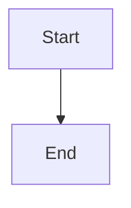

# Persist fair background audit reassessment and truthful incident projections

## Parent Epic

epic_044

## Scope

Own epic success criteria 1, 3, 4, 8, 9 and producer-side regressions in 10–11. Define/version the shared current/coverage/history projection and source/generation identity contract before consumer implementation. Extend the existing supervisor audit lane with durable pending coverage, fair rotation between ongoing and historical unresolved work, bounded per-item isolation, pass evidence reuse and restart-safe coalescing. Publish atomic bounded snapshots/history indexes; retain source ledgers unchanged. Record occurrence, observation and freshness separately; unknown/deleted/rerouted work must stay explicit. Legacy identity may be reconstructed only from unambiguous durable evidence with provenance; otherwise classify as historical/unverifiable. Keep fresh authoritative checks at every repair/admission boundary and existing owner investigation delivery/cooldown semantics. Verify slow-first-item plus later current blocker, repeated generations, completed publication obligations, restart and obsolete-generation repair rejection. Establish producer budgets and schema fixtures for subsequent features. No new dependencies or recovery-policy changes.

## Data structures

TBD.

## API contracts

TBD.

## Logic flow

## Task breakdown

_(empty — Feature Team mints tasks after dispatch)_

## Risks & upward questions

None.

## Decision log

None yet.
