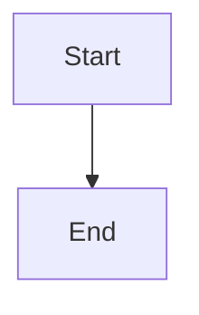

# Serve bounded read-only audit snapshots and paginated history

## Parent Epic

epic_044

## Scope

Own epic success criteria 2, 5, 7, 8 and API-side regressions in 10–11. Consume feat_044_001's versioned durable projection. Remove all lifecycle/Git/provider/worktree probes and state writes from dashboard GET paths, including indirect calls. Provide current incidents plus aggregate coverage and bounded expandable coverage/history pages with stable references and work/owner/outcome/time filters; preserve original durable records. Fail closed to explicit pending/unknown for absent, stale, corrupt or incompatible snapshots and root/epoch mismatch. Maintain split product/tracking routing. Enforce bounded regular-file reads, page and byte limits, immutable pagination consistency and explicit truncation/coverage. Authenticated manual audit retains existing scheduling and admission authority; GET never schedules scans or repairs. Prove repeated concurrent GETs do no probes/writes and remain bounded on a representative large ledger. Preserve necessary legacy client compatibility during rollout.

## Data structures

TBD.

## API contracts

TBD.

## Logic flow

## Task breakdown

_(empty — Feature Team mints tasks after dispatch)_

## Risks & upward questions

None.

## Decision log

None yet.
