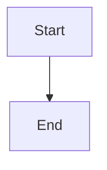

# Explain feature activation readiness and actual dispatch waits

## Parent Epic

epic_045

## Scope

Deliver the activation explanation end to end: authoritative Python readiness projection, board/API serialization, and compact accessible War Room presentation. This feature owns epic success criteria 1–5 and the activation-specific additional validation; the next feature consumes its action contract for new work.

Acceptance:
- Every open, not-yet-active feature has one summary: needs your action, waiting on another work item/system, ready awaiting dispatch, or readiness unavailable. Supply primary reason, additional blockers, satisfied prerequisites, actor/next action, affected work IDs and valid existing action/review links.
- Extend canonical evaluations in cascade/feature/readiness.py and cascade/stacked_dispatch.py to retain actual blocking sibling identities and distinguish execution from merge/review. Preserve serial/stacked policy and action-boundary refusals; never manufacture a declared dependency.
- Cover approval/reapproval, authoritative dependency outcomes (including unavailable), parent inactivity/cancellation, dispatch base, blocking review threads, provider/preflight and required merge/review. Reuse revision-bound approvals and cached provider inventory; do not implement gate logic in JavaScript.
- Version the additive explanation contract; preserve approved/blockers compatibility. Include evaluation time, source freshness and last actual dispatch attempt/refusal when present. Absent/stale required evidence is unknown/rechecking, never ready. A historical refusal cannot override a newer valid evaluation without being labeled historical.
- Polling uses a shared bounded snapshot and performs no dispatch, approval, lifecycle writes, provider discovery or new expensive Git checks. Actual dispatch still rechecks canonical gates and records its own refusal evidence.
- Show a deterministic primary reason and expandable secondary reasons/satisfied prerequisites; fresh human-action blockers remain visible even with simultaneous waits/unknown evidence. Reuse existing dependency display and plan/review/provider actions; expose missing evidence rather than a dead link.
- Reproduce approved 034_008 with satisfied 006/007 and supported provider, blocked by active 034_009. Name/link the sibling and explain the one-active-feature rule without implying failure or reapproval; completion refreshes readiness without extra approval. IDs are fixture data only.
- Test simultaneous blockers, review versus execution, inactive/cancelling parent, changed-plan approval, missing/stale evidence, empty blockers awaiting dispatch, a real dispatch refusal, and serial/stacked compatibility. Assert render/poll does not invoke dispatch or expensive preflight.
- Add focused Python API/integration regressions and browser coverage for expansion, existing action links, keyboard access and text/screen-reader labels. No redundant unit suite or test-only feature.

Boundaries: no automatic approval, scheduler redesign, notification stream, new dependencies, or epic_044 dependency. Preserve inherited Codex provider/model/reasoning defaults. Keep creation/acknowledgement storage out of this feature. Before task execution, document the exact explanation schema, source and freshness policy of each fact, primary-reason ordering and dispatch-refusal persistence in this feature plan.

## Data structures

TBD.

## API contracts

TBD.

## Logic flow

## Task breakdown

_(empty — Feature Team mints tasks after dispatch)_

## Risks & upward questions

None.

## Decision log

None yet.
