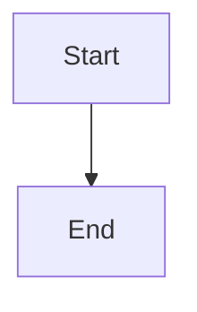

# Highlight newly added features with durable explicit acknowledgement

## Parent Epic

epic_045

## Scope

Deliver durable New markers and explicit Mark seen acknowledgement across the Epic and Feature board views, consuming feat_045_001's activation summary/actions. This feature owns epic success criteria 6–16, including the complete motivating operator journey.

Acceptance:
- Key attention records by stable feature ID within the workspace, recording durable creation/discovery provenance separately from immutable acknowledgement. FeatureMinted provides new-creation evidence; reconcile otherwise legitimately discovered IDs once, without relying on date/order/path/status changes. Replay and worktree relocation cannot recreate acknowledged newness.
- Use a small versioned, atomic, process-locked workspace state store rooted in the canonical tracking workspace (resolved across product/tracking split and managed worktrees). Record creation/discovery provenance, rollout baseline, acknowledgement actor/time and monotonic state revision. No plan edits or lifecycle changes for acknowledgement.
- Acknowledgement is workspace-shared in the current local-operator model, explicitly disclosed in UI/docs; authenticate Mark seen through the existing human verifier and record its subject. No new login/account service. Agent reads, GET/render, expanding/scanning and scroll never acknowledge; invalid/unauthenticated writes fail without mutation.
- Provide explicit feature-level Mark seen from board/review surface. It is idempotent; preserve acknowledgement under stale polls, retry, concurrent clients, restart, event replay, plan revision, relocation and branch rebase. Do not couple approval to acknowledgement in this initial slice.
- One-time rollout baseline: conservatively expose currently open backlog/ready-to-plan features under active, non-cancelling epics as unseen (including 034_008/009 if still in that cohort), regardless of current approval; record all other preexisting identities as baseline so historical work is not rediscovered. No blanket completed/active-history badges. Do not reset approval or emit bootstrap toasts.
- Newly created features after baseline stay New until explicit acknowledgement; completed/cancelled/retired children are excluded from pending-attention counts. Preserve provenance and acknowledgement through terminal transitions and reactivation; plan revisions retain the separate changed-plan indicators.
- Add accessible text New beside feature rows with separate lifecycle status and canonical next action. Collapsed epic rows show accurate new-feature counts and a keyboard-operable reveal control that expands/navigates to those children and opens their plans. Maintain stable asynchronous updates, readable theme contrast and useful screen-reader labels, without repeated toasts or animation.
- Missing/corrupt attention state must be exposed as unavailable rather than silently re-baselining, acknowledging or flooding history; durable acknowledgement writes must report failures accurately.
- Verify one API/state integration matrix spanning corrective minting, initial bootstrap, auth/write separation, repeat acknowledgement, polling, replay, restart, concurrent responses, revisions, completed/cancelled children and split roots. Verify product repository/approvals/status/blockers remain untouched by acknowledgement.
- Demonstrate in a real browser: active epic with completed sibling adds two corrective features; collapsed aggregate reveals them; open plans, understand approval needs, mark each seen, refresh/restart and observe no reappearing badges. Completed sibling remains unchanged and approval stays explicit. Reuse backend invariants rather than duplicate them at every test layer.

Boundaries: depend only on feat_045_001 for the authoritative next-action contract; no general unread/comments system, scheduler changes, notifications, external services or new packages. Preserve inherited Codex defaults. Before task execution, pin exact state ownership, provenance/bootstrap crash recovery and request/response concurrency contract in the feature plan.

## Data structures

TBD.

## API contracts

TBD.

## Logic flow

## Task breakdown

_(empty — Feature Team mints tasks after dispatch)_

## Risks & upward questions

None.

## Decision log

None yet.
