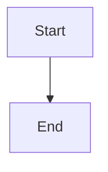

# Repair architecture publication for owned planning worktree lineage

## Parent Epic

epic_045

## Scope

# Repair architecture publication for owned planning worktree lineage

## Intent

Restore normal revision-pinned architecture review publication from an epic or feature integration worktree without requiring its unapproved plan to already exist on trunk. This is scoped orchestration repair discovered while investigating audit case investigation_4ca123bb9bd945fb98958705e01035af, not a third product slice or an audit-dashboard redesign. Feature Lead should mint a bounded SWE repair task after normal human approval; do not implement through the Epic Manager planning turn.

## Evidence

On 2026-11-12, epic_045 plan 48c4ce6ee0ca6aed8c6bba9ca1de7256f8ef83ef is an ancestor of owned epic HEAD d6148184bb10c5db69896ad4e5ba87c60421167a but not product/tracking trunk HEAD 646dc4cc9e68ea186725be13001c540c6489ae26. The plan remains current via read_doc and both planning sign-offs. Publication architecture-publication-8c50299f2d09024614cc747b5675c39fee6fd8faefa3622c2aa3b8c9a193e936 is superseded/artifact_changed with message 'pinned review plan revision is not in the current lineage', and no review unit exists. Exact proposal is retained at .cascade/epic_045_architecture_publication.json in the epic worktree; DESIGN.md is committed at 470b40632a065594ef499c5650b98e5fb74d4d72.

cascade/workspace/architecture_publication.py::_publish_validated stages without an owned lineage revision. cascade/workspace/architecture_review.py::_validate_current_artifacts resolves tracking-role plan validation against the configured repository HEAD, even when target and tracking share a repository with an owned integration worktree. Fix the canonical resolution, not these specific IDs. A separate publication using changed repository-role identities failed destination_changed; role relabeling is not an authorized workaround.

Fresh bounded project_audit_observation for epic_045 succeeds with expected_wait/plan_approval and no evidence errors; do not conflate that recovered missing-revision observation with this durable publication failure. No duplicate live architecture-publication repair was found in the merged board inventory.

## Acceptance criteria

1. Resolve and validate the exact authorized owning plan/design lineage from registered integration and tracking ownership. Normal epic/feature publication can stage current committed artifacts before trunk integration. Preserve repository keys, configured roles/destinations, byte digests, ownership, ancestry, generation and revision checks.
2. Reject genuinely changed, unrelated, missing or stale artifacts. Explicitly cover colocated and split product/tracking repositories; never substitute a product revision for a separate tracking revision.
3. Recover a previously terminal publication through the supported canonical recovery/publication path once the defect is repaired. Preserve its failure history and pinned proposal; no manual ledger edits, invented generation, main rewrite, early merge or approval bypass. Define the smallest safe retry behavior if identical idempotent replay would otherwise remain superseded forever.
4. Add focused regressions in existing architecture publication/review tests using distinct trunk and owned branch heads, current and changed plan/design bytes, and split roots. Run relevant checks in an isolated SWE worktree and publish the repair review canonically. No new dependencies or installations.
5. After accepted repair is available, the Epic Architect retries epic_045's exact current proposal through its authorized tool and records the review unit/status. Do not claim operational recovery merely from passing tests or queuing this feature.

## Boundaries and handoff

Backlog repair requiring normal human plan approval and task dispatch. Preserve inherited Codex role/model/reasoning defaults. No changes to activation/readiness product scope, attention state, audit scheduling, or approval policy. It has no artificial dependency on Features 001/002; their product dependency remains 002 on 001. This repair does not authorize activating those features. Report validation, review and runtime recovery separately to epic_045.

## Data structures

TBD.

## API contracts

TBD.

## Logic flow

## Task breakdown

_(empty — Feature Team mints tasks after dispatch)_

## Risks & upward questions

None.

## Decision log

None yet.
