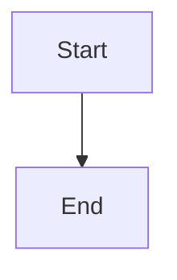

# Resolve exact work owners and preserve descendants before retirement

## Parent Epic

epic_047

## Scope

## Outcome and scope
Make lifecycle mutations select the exact registered owner and make parent retirement preserve the terminal truth of every required descendant. Owns epic success criteria 8–9 and the persistence portion of 15.

## Required behavior
- Resolve mutation roots using work ID, parent relationship, registry identity, branch and canonical provenance. A sibling checkout's completed historical copy is read evidence only; column rank and a generic feature-worktree path bonus cannot authorize mutation.
- Handle colocated and split product/tracking roots. Missing or conflicting ownership returns a typed, actionable refusal or uses an existing admitted reconstruction path; never fall back to arbitrary writes.
- Before any parent worktree removal, prove required child terminal documents and completion/delivery provenance survive in the authorized parent/tracking destination. Persist missing terminal records canonically, then re-read them before removing the checkout. Preserve branches, dirty/protected work, unmerged source revisions and unresolved review obligations.
- Repeated reconciliation and retirement must retain Task terminal state across board, execution ledger, delivery action and rollup; a stale active Task checkout must not resurrect completed work. Preserve compatibility with existing terminal records and legacy ambiguous states.

## Boundaries and implementation
Start with cascade/workspace/integration_worktree.py (merged_board, _meta_preference, retire_integration_worktree, terminal_doc_persisted_outside_worktree), cascade/workspace/doc_root.py::resolve_doc_worktree and cascade/boss/rollup.py::_retire_feature_worktree. Distinguish read precedence from mutation authority. Expose a reusable owner/retirement-proof contract for the late-repair lifecycle feature; do not invent a second registry or ledger.

## Task planning and acceptance
Budget approximately three cohesive Tasks: exact owner resolution; descendant durability/retirement gate; integration regression and reconciliation. Split only when scopes are independently reviewable.
Tests must cover the sibling-completed-copy/real-owner-backlog case, missing owner, changed registry/branch, split roots, parent persisted but last terminal child absent, dirty/locked worktree, interrupted persistence and restart. Exercise production persistence and removal gates in temporary repositories, not hand-edited success ledgers.
Every Task acceptance criterion must name affected owning DESIGN.md paths, C4 view keys, real source symbols, normal/failure flow, source-contract validation and evidence.

## Design and diagram ownership
Own proposed REQ-WORKSPACE-OWNER-001 and REQ-WORKSPACE-RETIRE-001 in cascade/workspace/DESIGN.md; reference REQ-BOARD-001 and REQ-BOSS-001 without duplicating ownership. Update parent summaries in cascade/DESIGN.md and affected Board/Boss interface descriptions.
Own the Workspace component's focused integrated Code view (proposed key cascade-workspace-code, cascade.codeComponent=element.component.workspace) and relevant cascade-supervisor-components relationships. Coordinate the Boss retirement caller with its Code-view owner. Keep model.dsl, views.dsl and workspace.contract.json synchronized. Context/container topology is unchanged: these remain local supervisor/repository responsibilities, not new services.
The Epic Architect must reconcile the proposal before epic sign-off; implementers reconcile against actual code and record validation at closeout.

## Constraints
Inherit Codex and the epic's exact role model/reasoning settings. No dependency installation, trunk mutation, destructive cleanup or approval bypass. Do not claim reviewed/integrated state from Task delivery alone.

## Data structures

TBD.

## API contracts

TBD.

## Logic flow

## Task breakdown

_(empty — Feature Team mints tasks after dispatch)_

## Risks & upward questions

None.

## Decision log

None yet.
