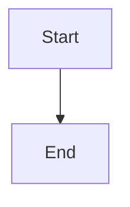

# Admit late repair generations without losing accepted review history

## Parent Epic

epic_047

## Scope

## Outcome and scope
Provide one executable owner-scoped recovery lifecycle for repair under active, review-staged and accepted Features. Preserve the existing Task and require review of the actual repaired source head. Owns epic criteria 1–4, 7 and 10, with core transaction/regression coverage.

## State and authority contract
- Active parent: ordinary admission and Task delivery. Review-staged parent with an open review: admit a repair generation and reactivate the same Feature through a durable authorized transaction; invalidate current completion eligibility and refresh the open publication only after relevant validation.
- Accepted parent: keep the historical review and its accepted source/target/merge heads immutable. Admit an in-scope repair generation for the same Feature and same Task identity, recording a distinct linked follow-up review/publication obligation. The old merged review cannot satisfy it. Scope changes outside current approvals require the existing amendment/corrective-work approval path or an explicit human prerequisite, never automatic reparenting or duplicate Tasks.
- Unknown forge/ownership state fails closed. Reactivation is conditional on an executable authorized route, not every completed Feature being reopened.
- Reuse the existing durable action ledger, lifecycle lock and generation/claim machinery. Persist intent, exact authority and recovery identity before introducing an active path; make the watchdog validate this operation's receipt and generation. Do not synthesize FeatureReadyToPlan as if a fresh human dispatch occurred.
- Resume incomplete transactions after restart under the same identity and fresh ownership/head/lease checks. Crash boundaries before/after authority, document move, review-obligation publication and acknowledgement must converge without duplicate events or work.
- Admission must check plan/revision approval, relevant comments, dependencies, execution leases, protected/dirty work and exact Task source/target validation pair. A moved head requires the existing Task synchronization/final validation path; preserve committed work and append history before rearming. Green validation on an old pair is insufficient.

## Completion and review contract
mint_task must not expose a newly nonterminal child without a legal parent delivery route. Serialize repair admission with closeout. Move all outstanding-child and publication-obligation checks before the already-completed fast path. Fresh forge facts and pinned heads distinguish Task delivery, review acceptance, parent integration and runtime deployment.
Preserve history of prior review/action generations; legacy records must not acquire approval of later code by inference. Feed current review obligations to the retirement proof from the prerequisite feature.

## Boundaries
cascade/feature/mint.py; Feature/Epic recovery adapters; cascade/boss/rollup.py and merge.py; cascade/workspace/branch_synchronization.py; cascade/task final validation/action recovery; cascade/watchdog/loop.py authorization; cascade/review.py and review reconciliation. Reuse existing reviewed publication/rebase and stacked-review recovery mechanisms; no second scheduler, queue or unrestricted lifecycle editor.

## Task planning and acceptance
Budget three to four cohesive Tasks: generation/authority transaction plus replay; mint/completion/review integration; preservation and revalidation of original delivery; focused race/failure regressions where needed. Each Task must test one normal and one refusal/resume path through production gates.
Cover active/open/merged reviews, concurrent repair/closeout, head movement on either side, stale generation, changed owner, live lease, dirty/missing checkout, unresolved human comments, missing approvals/dependencies, replay at each durable boundary and old-PR callbacks after a follow-up exists.

## Design ownership
Proposed REQ-FEATURE-REPAIR-001 and DEC-FEATURE-REPAIR-001 belong to cascade/feature/DESIGN.md; REQ-BOSS-CLOSEOUT-001 to cascade/boss/DESIGN.md; REQ-REVIEW-REPAIR-001 to cascade/DESIGN.md; authorization implications belong to cascade/watchdog/DESIGN.md and validation reuse to cascade/task/DESIGN.md.
Update cascade-feature-code and cascade-task-code; own a focused integrated cascade-boss-code view (element.component.boss) including closeout, merge and review collaborators. Coordinate generation authorization nodes with cascade-watchdog-code owner. All nodes require actual sourcePath/sourceSymbol and contract declarations.
Feature Tasks must include source-linked state/sequence diagrams, persistent state and crash ordering, parent links, contract validation, supported rendering and full context→container→component→Code navigation acceptance. Proposed symbols must not be documented as implemented. Retain exact role/provider settings from the epic.

## Data structures

TBD.

## API contracts

TBD.

## Logic flow

## Task breakdown

_(empty — Feature Team mints tasks after dispatch)_

## Risks & upward questions

None.

## Decision log

None yet.
