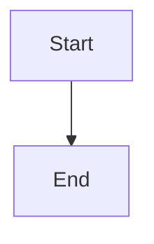

# Execute lifecycle mismatch recovery through parent and audit supervision

## Parent Epic

epic_047

## Scope

## Outcome and scope
Turn a completed-parent delivery mismatch into one admitted, verifiable recovery action instead of repeated impossible merges or team wakeups. Owns epic criteria 5–6 and 12; extends the lifecycle capability from the prerequisite feature.

## Required behavior
- Classify completed-parent not_active as a deterministic lifecycle prerequisite. Preserve validated Task/action identity and historical attempts. Live-turn busy remains an expected transient wait.
- Route once per meaningful evidence/generation to the exact accountable lifecycle owner. Ordinary sweeps must not consume merge attempts or provider turns for unchanged impossible delivery. Reassess on ownership, source/target, review/approval/lease or repair-result changes, with bounded policy for missed events.
- Feature self-recovery, immediate Epic supervise_child/recover_feature, and admitted audit recovery must invoke the same canonical operation and report selected operation, owner, acknowledgement, refusal or durable result. A TeamMessage or worker start is not successful recovery.
- If the required capability is absent or an orchestration defect persists, create a deduplicated scoped repair handoff under an eligible owner or expose a precise operator prerequisite. Respect all approval and dependency gates. Track request→acknowledgement→execution→authoritative verification and stop recurring unchanged investigation turns.
- Expose one typed incident across Task, parent and periodic-review projections: work/recovery identity, generation, reason, blocked operation/owner, validation pair, prior and required review, selected action, freshness and verified outcome. Keep bounded read-only audit projections; do not redesign the audit dashboard.
- Clear incidents only after fresh authoritative postchecks prove the associated delivery/publication/persistence obligation, including restart.

## Boundaries
cascade/task_rollup.py; cascade/task/action_recovery.py and supervisor recovery; cascade/team_supervision.py; cascade/feature/recovery.py; cascade/epic/recovery.py; cascade/watchdog incident/admission/audit_recovery/audit_investigation paths; minimal Board/War Room projection consumers.

## Task planning and acceptance
Budget two to three cohesive Tasks: deterministic refusal routing and executable adapters; durable missing-capability handoff/typed projections; integration coverage as needed.
Use production recovery admission/claim machinery to prove one recovery across simultaneous Feature/Epic/audit requests, stale generation rejection, live-owner waits, restart/replay, unavailable capability, acknowledged-but-unexecuted requests, bounded reassessment and no duplicate messages/publications/worker turns. Preserve gate refusals and action history.
Feature Task acceptance must include affected design/model inventory and exact evidence, including source-linked authority boundaries.

## Design ownership
Own proposed REQ-WATCHDOG-REPAIR-001 and REQ-CASCADE-RECOVERY-001 in cascade/watchdog/DESIGN.md and cascade/DESIGN.md; link validation and lifecycle invariants to their existing owners. Update cascade/epic/DESIGN.md, cascade/task/DESIGN.md and cascade/war_room/DESIGN.md for adapter/consumer implications only.
Own proposed cascade-watchdog-code (element.component.watchdog) with admission, claims, typed observations, recovery execution and postcheck nodes; update cascade-epic-code and relevant task/team views to show callable adapters. Coordinate Feature/Boss nodes with the lifecycle feature and Workspace with the ownership feature. Preserve host execution/isolation facts and render bounds. No new C4 container or external service.
Inherit exact Codex/model/reasoning selections; no automatic installation or fabricated authority.

## Data structures

TBD.

## API contracts

TBD.

## Logic flow

## Task breakdown

_(empty — Feature Team mints tasks after dispatch)_

## Risks & upward questions

None.

## Decision log

None yet.
