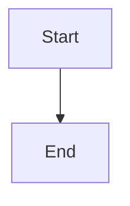

# Prove late repair convergence and document reviewed runtime handoff

## Parent Epic

epic_047

## Scope

## Outcome and scope
Demonstrate the complete late-repair workflow through real lifecycle boundaries, preserve the existing GitHub CLI compatibility fix, and provide a supported handoff for updating a supervisor whose running code blocks reconciliation. Owns epic criteria 11, 13–15 and final cross-feature acceptance; preceding features still own their focused tests and designs.

## Compatibility and runtime handoff
The current cascade/tracking.py::merge_request_snapshot already requests commits instead of unsupported headRefOid and extracts commits[-1].oid; retain it. Existing tests/test_tracking_find.py and tests/test_review_health.py assert query fields. Strengthen contract coverage with a real installed CLI-supported query/response shape, pinned source SHA, empty/malformed commits and moving-head refusal as relevant. Preserve merge SHA, mergeability, comments, descriptions and GitLab normalization. Do not introduce a CLI upgrade or claim a new repair of already-fixed code.
Document and exercise the supported reviewed deployment handoff: identify reviewed source and expected running revision, drain/stop through existing operator controls, update/start from the reviewed checkout through supported installation/start procedures where separately authorized, and record the executing revision plus post-restart review-health result. When old code cannot admit the repair, expose that exact operator prerequisite and retain delivery. No internal Python invocation, manual lifecycle/event edits, runtime hotpatch or claimed deployment from a local merge.

## End-to-end acceptance
Build temporary-repository scenarios using normal mint, dispatch, supervised final validation, queued delivery, parent supervision, review-health and watchdog admission. Forge boundaries may use contract-accurate deterministic transport, while CLI schema compatibility has separate actual-binary evidence.
Reproduce active/open-review and already-merged-review repair, plus repair racing closeout. Existing Task identity and validated work survive. Show the follow-up review covers the later source head and correct target, not merely successful Task merge.
Cover source and target movement, stale generations, live owners, dirty/missing checkout, changed owner, comments/approval/dependency refusals and split roots using shared high-signal scenarios rather than a combinatorial duplicate suite.
Include the misleading sibling completed copy and retirement with a missing last terminal child elsewhere. Restart workers and run repeated sweeps. Assert one durable repair, no falsely active queue/incident, coherent execution/board/rollup, preserved original and follow-up review facts, and discoverable terminal descendants after retirement.

## Task planning and evidence
Budget two cohesive Tasks: end-to-end convergence matrix and CLI/deployment contract coverage; a separate architecture/UI verification Task only if it has material implementation work. Do not create tests mirroring every helper.
Before completion run the configured bounded publication safeguards for any conflict resolution, focused affected suites, the complete scenario matrix, and architecture source-contract validation plus supported real rendering. Record exact commands, revisions, outcomes, any baseline failures and unperformed external gates. A mocked success result or team wakeup is not end-to-end evidence.

## Architecture closeout
Reconcile the epic's full diagram inventory against final code: model.dsl, views.dsl, workspace.contract.json; root/package and owning Workspace, Feature, Boss, Watchdog, Epic, Task, Board/War Room designs as affected. Preserve accepted snapshots.
Verify actual UI traversal context→containers→components→Code, Level up, deep-link restoration and pinned source for representative recovery/ownership/retirement nodes. Test stale renamed/deleted symbols and wrong component ownership. Record cold/warm timings and reuse of the bounded single-batch renderer; no per-view startup or universal latency promise.
Record concrete unchanged-level reasons and unresolved review/deployment prerequisites. Keep delivery history in work records and current architecture in designs. Inherit exact epic role/provider settings.

## Data structures

TBD.

## API contracts

TBD.

## Logic flow

## Task breakdown

_(empty — Feature Team mints tasks after dispatch)_

## Risks & upward questions

None.

## Decision log

None yet.
