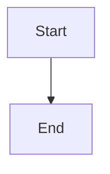

# Enforce durable incident budgets at recovery admission

## Parent Epic

epic_048

## Scope

## Outcome
A recovery incident retains one finite allowance across action IDs, generations, restarts and escalations. Unchanged deterministic failure cannot start a second expensive check. Material change permits reconsideration only against remaining cumulative allowance or an independently authorized extension.

## Scope and ownership
Own the incident identity, lineage, reservation, consumption and extension contracts in the existing recovery stores and lifecycle locks: cascade/watchdog/incidents.py, reservations.py, cascade/task/action_recovery.py, and the team review/review-validation admission boundary. Reuse current exact-SHA publication and process cleanup. Do not introduce another scheduler/database. Coordinate provider consumers through a documented interface for F2; paid-work enforcement is completed there.

## Acceptance criteria
- Epic success criteria 3–7 and 16–19: persist original incident identity separately from material generation; linked actions/children cannot self-assign a fresh budget. Retain legacy decisions and attempts. Ambiguous legacy lineage or consumption waits for an explicit owner decision; known exhausted history needs a bounded extension.
- Atomically reserve allowance before an expensive process; reconcile once by operation identity, retaining uncertain in-flight consumption after crashes. Concurrent owners cannot overspend or reclaim a live owner. Track attempts, validator/process time and elapsed time separately; preserve original start time and usage across policy cycles, provider switches and cosmetic revisions.
- Replace automatic attempt-bound growth in admit_review_publication_generation with both generation admission and cumulative-budget admission. Same deterministic failure runs once; transient default is at most three total attempts with bounded exponential backoff/jitter. Unknown failure classification fails conservatively.
- Implement the epic's proposed bounded defaults/maxima under trusted repository/operator policy. Budget policy version is part of admission. Extension uses authenticated independent authority, reason, added bounded allowance and retained prior consumption; a retrying agent cannot self-grant it. Exhaustion creates one durable escalation and leaves delivery unresolved.
- Retain the production publication regression and add a narrow real-process/bare-remote journey proving timeout once, restart suppression, authorized policy correction/extension, exactly one useful next publication, old resolved decision retention and independent remote verification. Assert real spawn/push counts, not only statuses.
- Unit boundaries only where integration evidence does not cover them. No broad refactor of unrelated action kinds.

## Designs and diagrams
Own REQ-RECOVERY-BUDGET-001 and DEC-RECOVERY-BUDGET-001 in cascade/task/DESIGN.md (new proposed IDs); use existing REQ-WATCHDOG-REPAIR-001 and REQ-REVIEW-PUBLISH-001 as linked authority contracts. Update cascade/DESIGN.md and cascade/watchdog/DESIGN.md at the interfaces. Affected views: cascade-supervisor-components, cascade-task-code, cascade-watchdog-code, and the existing team/publication component's integrated Code coverage. Define exact reservation/usage/extension entry points in the feature plan before tasking.

## Required Task acceptance contract

Feature planners must copy the applicable epic diagram-impact rows into Task acceptance criteria and budget that work with the implementation. Preserve existing requirement owners; proposed new IDs become current design facts only after implementation is reconciled. Update owning DESIGN.md, model.dsl, views.dsl and workspace.contract.json together when structure changes. Native custom Code views must link real source symbols and declaration kinds, support context → container → component → Code, Level up, deep links and pinned source. Include normal and failure/restart flows, persistence, authority and process isolation limits. Verify source contracts, supported local rendering and representative browser navigation; record actual evidence and gaps in work records. Do not rewrite accepted architecture snapshots.

Use production tool adapters, durable stores and real temporary repositories/processes for integration proof. Scripted external provider/forge transport is permitted; fake successful repair, validation, publication or final verification is not. No raw success setters or lifecycle-file edits to force progress. Tests must count effects independently. Keep product acceptance separate from review validation. Preserve Codex and the parent's explicit role/model/reasoning assignments. No dependency installation or live deployment is authorized by this feature.

## Data structures

TBD.

## API contracts

TBD.

## Logic flow

## Task breakdown

_(empty — Feature Team mints tasks after dispatch)_

## Risks & upward questions

None.

## Decision log

None yet.
