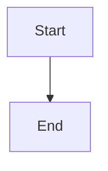

# Execute and independently verify the bounded owner-agent repair journey

## Parent Epic

epic_048

## Scope

## Outcome
An admitted incident reaches a real accountable owning team, which diagnoses, repairs, tests, commits, delivers and publishes through its scoped tools; a fresh authoritative postcheck alone resolves the original incident. Every paid repair/investigation turn consumes the F1 allowance before provider launch.

## Scope and ownership
Connect existing worker/watchdog queue, audit investigation outbox, parent supervision, tier graphs/tool catalogs, provider adapters and review publication. Extend cascade/agent/types.py, adapter.py and provider adapters only as required for attributable invocation evidence and bounds. The scripted transport harness must run through production tool adapters and receive actual refusals. Establish one executable positive journey before expanding the matrix.

## Acceptance criteria
- Epic criteria 1–7, 9–12 and 16–19: observable stage receipts distinguish detected/admitted/assigned/executing/validating/publishing/verifying/resolved/waiting. Acknowledgement, reported_fixed, provider finished and remote push cannot stand in for verification.
- Resolve each repair to actor, capability, permitted inputs, authority revision and durable result. Missing tools or policy owner cause one executable handoff or precise external wait. Genuine human/installation/credential/comment/scope gates remain closed.
- Validation profiles identify command, coverage class, owner, approval/version and finite budget. Task, review and epic acceptance remain distinct. Preflight declared feasibility and retained timeout evidence; never learn feasibility by unbounded repeats. Select only applicable approved profiles.
- Before provider start reserve a model turn and worst-case time from the original incident, including audit/briefing and parent/replacement-action paths. Capture provider/model/invocation ID and known/estimated/unavailable usage; cached tokens are a subset, not additive usage. No invented token total or bill. Provider cancellation and enforceable output limits bound supported overshoot; unknown usage retains conservative turn/time charging.
- A canonical invocation receipt is settled exactly once across callbacks/restarts. Prefer one recovery incident per turn; shared turns require predetermined lineage allocation and reservations for every participating incident, with one physical invocation record and no double-counted global usage. Ambiguous attribution cannot create free paid work.
- Extend the integration harness through real worker/queue/checkpoint/role-scoped tool dispatch, Task test/commit/delivery, owner publication and independent remote/postcondition observation. Script only external paid-provider/forge transport. Retain real red checks and process-group timeout cleanup.
- Replay the timeout + legacy exhausted next-decision sequence through the owner tools, with an approved policy correction and authorized extension where required. The unavailable-owner variant stops with the owner and next action.
- Paid-work budget exhaustion blocks repeat audit/investigation commissions but leaves unrelated work eligible. Test direct/manual/periodic/provider-switch entry points, denied extension, authorized extension and duplicate dispatch concurrently.

## Designs and diagrams
Own proposed REQ-AGENT-RECOVERY-001 / DEC-AGENT-RECOVERY-001 in cascade/agent/DESIGN.md and link F1's budget authority. The cross-stage receipt interface is proposed REQ-CASCADE-RECOVERY-002 in cascade/DESIGN.md; watchdog owns postchecks, not provider adapters. Reconcile cascade/{watchdog,epic,feature,task}/DESIGN.md plus affected War Room projections. Update cascade-agent-code, cascade-watchdog-code, cascade-teams-code, affected epic/feature/task code views, supervisor/team component views, and dashboard code only if its producer/consumer interface changes.

## Required Task acceptance contract

Feature planners must copy the applicable epic diagram-impact rows into Task acceptance criteria and budget that work with the implementation. Preserve existing requirement owners; proposed new IDs become current design facts only after implementation is reconciled. Update owning DESIGN.md, model.dsl, views.dsl and workspace.contract.json together when structure changes. Native custom Code views must link real source symbols and declaration kinds, support context → container → component → Code, Level up, deep links and pinned source. Include normal and failure/restart flows, persistence, authority and process isolation limits. Verify source contracts, supported local rendering and representative browser navigation; record actual evidence and gaps in work records. Do not rewrite accepted architecture snapshots.

Use production tool adapters, durable stores and real temporary repositories/processes for integration proof. Scripted external provider/forge transport is permitted; fake successful repair, validation, publication or final verification is not. No raw success setters or lifecycle-file edits to force progress. Tests must count effects independently. Keep product acceptance separate from review validation. Preserve Codex and the parent's explicit role/model/reasoning assignments. No dependency installation or live deployment is authorized by this feature.

## Data structures

TBD.

## API contracts

TBD.

## Logic flow

## Task breakdown

_(empty — Feature Team mints tasks after dispatch)_

## Risks & upward questions

None.

## Decision log

None yet.
