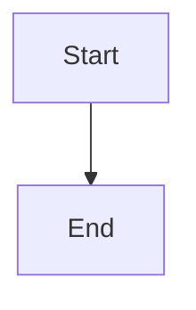

# Prove reviewed repairs are loaded and survive cross-stage delivery

## Parent Epic

epic_048

## Scope

## Outcome
Recovery of orchestration code has a supported bootstrap route and exact reviewed/integrated/loaded revision evidence. The completed-parent/late-child journey remains correct across delivery, cleanup, split roots and process restart.

## Scope and ownership
Build on the README runtime handoff, cascade/workspace/worker.py and supervisor/launcher lifecycle, existing health evidence, capability registry, Feature repair adapter, pending Task delivery and incident_postcheck. Reuse the late-repair and ownership implementation already present; fix only integration gaps demonstrated by this journey. No duplicate late-child or audit-dashboard project.

## Acceptance criteria
- Epic criteria 7–8, 10, 12–13: independently bind reviewed source, integrated source, installed artifact/source, loaded worker PID/start identity and capability generation. A healthy endpoint or source-tree HEAD alone does not prove loaded code.
- Normal reviewed deployment and a bootstrap path that does not depend solely on the broken adapter preserve approval/installation/credential authority. If no supported authorized path is available, return the exact external prerequisite; never hotpatch site-packages, dirty operator trunk or forge runtime evidence.
- Harness starts a real worker process from the reviewed repair revision in an isolated prepared workspace and checks its own loaded-revision report independently. Exercise repair to a recovery adapter itself and stale/dirty/unknown runtime rejection; do not replace the deployed postcheck with a successful mock.
- Cross-stage owner-tool journey composes existing completed-parent/late-child repair, immutable acceptance generations, parent integration, descendant-safe retirement and split product/tracking roots. After restart, board, execution record, pending delivery, owner, review registry, loaded capability and original historical incident agree.
- Crash after push and before receipt reconciles remote effect without another publication. A live owner, changed target, unavailable authoritative evidence, outstanding acceptance or unintegrated follow-up head remains pending. Original incidents stay candidates until verified.
- Concrete preflight for the later controlled operational exercise identifies target environment, exact runtime artifact/revision, authorized actor and supported entry points. New software or installation needs a separately approved manifest/authority before execution.

## Designs and diagrams
Own proposed REQ-WORKSPACE-RUNTIME-001 / DEC-WORKSPACE-RUNTIME-001 in cascade/workspace/DESIGN.md; link existing REQ-WORKSPACE-OWNER-001, REQ-WORKSPACE-RETIRE-001, REQ-TASK-DELIVERY-002 and REQ-WATCHDOG-REPAIR-001. Reconcile README operation instructions, package, Feature, Task and Watchdog interfaces. Affected integrated views: cascade-workspace-code, cascade-workspace-commands-code where launcher wiring changes, cascade-watchdog-code and affected feature/task code views; context/container views change only if an actual responsibility/runtime boundary changes.

## Required Task acceptance contract

Feature planners must copy the applicable epic diagram-impact rows into Task acceptance criteria and budget that work with the implementation. Preserve existing requirement owners; proposed new IDs become current design facts only after implementation is reconciled. Update owning DESIGN.md, model.dsl, views.dsl and workspace.contract.json together when structure changes. Native custom Code views must link real source symbols and declaration kinds, support context → container → component → Code, Level up, deep links and pinned source. Include normal and failure/restart flows, persistence, authority and process isolation limits. Verify source contracts, supported local rendering and representative browser navigation; record actual evidence and gaps in work records. Do not rewrite accepted architecture snapshots.

Use production tool adapters, durable stores and real temporary repositories/processes for integration proof. Scripted external provider/forge transport is permitted; fake successful repair, validation, publication or final verification is not. No raw success setters or lifecycle-file edits to force progress. Tests must count effects independently. Keep product acceptance separate from review validation. Preserve Codex and the parent's explicit role/model/reasoning assignments. No dependency installation or live deployment is authorized by this feature.

## Data structures

TBD.

## API contracts

TBD.

## Logic flow

## Task breakdown

_(empty — Feature Team mints tasks after dispatch)_

## Risks & upward questions

None.

## Decision log

None yet.
