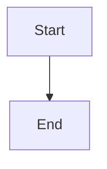

# Gate recovery with adversarial CI and controlled supervisor evidence

## Parent Epic

epic_048

## Scope

## Outcome
The completed recovery contract runs automatically and fails when a key safeguard is deliberately broken. Completion includes a controlled real supervisor recovery through supported entry points, with honest unresolved prerequisites.

## Scope and ownership
Own the shared recovery harness matrix, .github/workflows/recovery-contract.yml, bounded failure artifact capture, local setup/run documentation and the final evidence dossier. Extend prior features' high-signal integration scenarios instead of duplicating their tests.

## Acceptance criteria
- Epic criteria 9–19: retain existing review-recovery checks and run the actual owner-agent journey on relevant PRs and main. Named check remains Recovery contract; bounded CI job initially 10 minutes, failing on timeout, with sanitized evidence retained on failure. No optional/manual-only gate or silent prerequisite skips in the acceptance job.
- Cover actual red tests, insufficient budget, malformed policy, policy/head drift, stale admissions, remote competition, dirty/uncommitted changes, live owners, wrong scope, missing capability, denied approvals/credentials, unavailable evidence; crash before claim/during checks/after commit/after push/before receipt; normal and split roots.
- Independently count process/model/worker/Task/review/message/publication effects. Prove one unchanged expensive failure, transient cap, paid-turn cap, concurrent reservations, unknown usage and bounded overrun/cancellation. Restart/generation/cosmetic commit/provider switch/policy cycle/replacement action cannot reset allowance. Repeated audit requests remain coalesced after exhaustion. Test denied and authorized bounded extensions with prior history intact.
- Controlled fault mutations separately breaking deduplication, validation, immutable publication, independent postcheck and receipt recovery each fail the relevant test. Revert faults; never weaken checked-in production checks.
- Publish exact local commands, fresh-workspace prerequisites, revisions, profile/budget/actor/decision/claim IDs, restart points, retained diagnostics and independent remote/deployment observations.
- Execute a controlled real supervisor incident through approved UI/agent routes with normal review and installation boundaries. Record actual observed model usage or unavailable status, exact deployed revision, fresh verification and remaining acceptance obligations. If authority/environment is unavailable, preserve a named blocking prerequisite and do not recommend epic completion.
- Verify the final diagram inventory against implemented diff: supported source validation/rendering, UI context → container → component → Code, Level up, deep-link restoration and pinned-source opening; normal/failure isolation traces, stale renamed/deleted symbols and moved owners, warm artifact reuse and measured performance without per-view process launches.
- Acceptance requires both deterministic CI and supported operational evidence; passing this feature's tests alone cannot close the epic.

## Designs and diagrams
Reconcile all affected design owners from F1–F3 against final source. README owns setup/run instructions; work records own execution evidence and chronology. No new C4 container for the harness: it uses production boundaries and temporary test artifacts covered by the root design. Only actual runtime/interface deltas justify model edits.

## Required Task acceptance contract

Feature planners must copy the applicable epic diagram-impact rows into Task acceptance criteria and budget that work with the implementation. Preserve existing requirement owners; proposed new IDs become current design facts only after implementation is reconciled. Update owning DESIGN.md, model.dsl, views.dsl and workspace.contract.json together when structure changes. Native custom Code views must link real source symbols and declaration kinds, support context → container → component → Code, Level up, deep links and pinned source. Include normal and failure/restart flows, persistence, authority and process isolation limits. Verify source contracts, supported local rendering and representative browser navigation; record actual evidence and gaps in work records. Do not rewrite accepted architecture snapshots.

Use production tool adapters, durable stores and real temporary repositories/processes for integration proof. Scripted external provider/forge transport is permitted; fake successful repair, validation, publication or final verification is not. No raw success setters or lifecycle-file edits to force progress. Tests must count effects independently. Keep product acceptance separate from review validation. Preserve Codex and the parent's explicit role/model/reasoning assignments. No dependency installation or live deployment is authorized by this feature.

## Data structures

TBD.

## API contracts

TBD.

## Logic flow

## Task breakdown

_(empty — Feature Team mints tasks after dispatch)_

## Risks & upward questions

None.

## Decision log

None yet.
