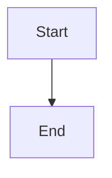

# Project evidence-based recovery progress

## Parent Epic

epic_049

## Scope

Deliver the shared recovery progress contract in epic_049, success criteria 1, 2, 4 and the producer/read boundary in 6. This feature owns canonical presentation state, not repair policy.

Required Task acceptance:
- Freeze a versioned safe entry with action/incident/generation/owner/attempt/claim identity, occurrence and observation times, review target, next prerequisite/owner, verification reference, provenance and freshness.
- Distinguish queued, acknowledged, live investigating, live executing, waiting/blocked, failed/exhausted, verification pending, verified completion and stale/unavailable. Match action + generation + attempt evidence. mutation_ready, enqueue, successful attempt and publication do not prove execution or verified resolution.
- Use existing action/incident/stage/postcheck sources and producer lifecycle. Publish a work-ID-addressable bounded current projection outside GET with direct committed-source notification for meaningful transitions; do not rebuild all retained audit history per event or add a scheduler/ledger/paid turn. The Epic Architect must resolve storage and producer hooks before final plan sign-off.
- Expose concurrent incidents with deterministic primary ordering and continuation. Keep board recovery_incident compatibility and provide additive identity/version metadata for the room. Never hide a newer blocker behind completed or older history.
- Bind live owner evidence to worker/process generation, validity and observation time. Expired, dead, inaccessible and legacy owners cannot claim execution. GET consumes published evidence only; no process/Git/provider probes, raw recovery scans, writes or checkpoint opening.
- Integration tests cover all states, stale/mismatched generation, conflicting evidence, concurrent actions and no read side effects. Use existing local manifest dependencies; install nothing.

Design ownership: War Room owns new progress requirements and safe public contract; Task owns source transitions; Watchdog owns producer freshness/postcheck; Workspace owns worker routing. Carry the epic diagram inventory into Tasks: cascade-dashboard-code, cascade-task-code, cascade-watchdog-code, affected cascade-workspace-code/cascade-teams-code and component ancestors. Add actual source symbols and native declaration kinds, keep model.dsl/views.dsl/workspace.contract.json synchronized, reconcile DESIGN.md without delivery history, and verify normal plus dead-owner/restart flows, context-to-Code navigation and pinned source opening. No invented future symbols in current designs.

Preserve Codex; feature_lead/feature_architect gpt-6-sol high and SWE gpt-5.6-sol medium. No child dispatch before normal plan approval. Return precise contract/API and tests for the dependent transcript/UI features.

## Data structures

TBD.

## API contracts

TBD.

## Logic flow

## Task breakdown

_(empty — Feature Team mints tasks after dispatch)_

## Risks & upward questions

None.

## Decision log

None yet.
