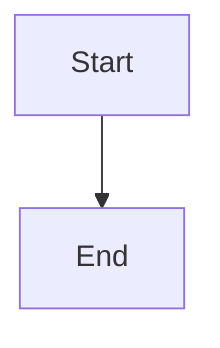

# Persist recovery milestones and bounded transcript history

## Parent Epic

epic_049

## Scope

Deliver epic_049 success criteria 3, 5 and the transcript half of 6 using Feature feat_049_001's common progress contract.

Required Task acceptance:
- After authoritative action/incident commits, publish concise System · Recovery milestones before the manager/architect turn completes. Cover request, acknowledgement, attempt start, supported stages, waits/failures, publication and independently verified completion. Do not generate narrative progress from a model.
- Use owning-graph transcript storage with additive event metadata, stable source references, occurrence time separate from append/reconciliation time, action/generation/attempt identity and deterministic transition keys. Distinct repeated stages need distinct source identities; observation timestamps alone cannot mint milestones.
- Specify and implement a cross-process atomic append/deduplication fence; existing process_lock alone is insufficient. Reconcile source-committed/chat-missing and chat-appended/cursor-not-advanced crashes through bounded resumable supervisor work. Failure to write chat preserves action evidence and never changes repair admission. No GET reconciliation, full-history polling, added recovery scheduler or extra paid turn.
- Preserve authored final summaries; deduplicate direct append/restart backfill by stable source message/checkpoint identity without suppressing separate identical authored messages. Label unknown legacy occurrence times and reconciliation provenance honestly.
- Freeze a versioned paginated chat interface with default 50/max 100 rows, 1 MiB source and 256 KiB serialized budgets, explicit continuation and cursor generation. Preserve legacy array shape through a bounded latest window with explicit continuation metadata. Never silently truncate or delete old history. Wrong/stale cursors return typed restart. Support incremental poll and load-older.
- Route to the owning epic/feature graph across dispatch/completion and split product/tracking roots; never place an event in another team's transcript.
- Exercise two actual concurrent writer processes, duplicate notifications, restart at each commit boundary, malformed/torn append behavior, missed transitions, unknown legacy times, distinct repeated stages, stable role deduplication, cursor overflow/expiry and large-history budgets. Assert reads do not append, open checkpoints or probe providers/Git/processes.

The parent Epic fixes the append/index/cursor protocol and compatibility shape; Feature planning must turn it into exact Task APIs before implementation.

Design/Code ownership: War Room transcript requirements, chat_store.py, planning_transcript.py, sidecar_routes.py and their native cascade-dashboard-code nodes; Task source notifications in cascade-task-code; kickoff owner/role-return boundaries in cascade-workspace-code/cascade-teams-code; Watchdog reconciliation in cascade-watchdog-code when used. Update owning designs, parent links, model.dsl, views.dsl and workspace.contract.json with real symbols/kinds. Show normal and crash replay sequences, persistent state, error behavior and source/design links. Verify integrated Code/Level up/deep links and pinned sources; do not overwrite accepted artifacts.

Preserve Codex feature_lead/feature_architect gpt-6-sol high and SWE gpt-5.6-sol medium. Use verified existing software; no installation or premature dispatch.

Architecture contract resolved by Epic decisions dec_004–dec_006. Required Task acceptance additionally implements the Epic's Selected storage and execution contract: stable tracking-root graph OS fence across all append/remove/sync writers; JSONL authority; durable pending-line intent plus SQLite event/offset index; fsync-before-index-commit and acknowledgement after fence release; exact-tail crash repair; immutable bounded read pages; incarnation and append-sequence cursors; resumable legacy import with honest unknown occurrence times; checkpoint-lineage/message-ordinal reply identity; routing handoff under the same fence. Include every crash injection and real two-process race in the Epic matrix. Freeze concrete versioned route/header names, Link continuation and typed legacy-unavailable response before dependent UI dispatch.

## Data structures

TBD.

## API contracts

TBD.

## Logic flow

## Task breakdown

_(empty — Feature Team mints tasks after dispatch)_

## Risks & upward questions

None.

## Decision log

None yet.
