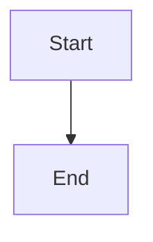

# Persist recovery milestones and bounded transcript history

## Parent Epic

epic_049

## Scope

Deliver epic_049 success criteria 3, 5 and the transcript half of 6 using Feature feat_049_001's common progress contract.

Required Task acceptance:
- After authoritative action/incident commits, publish concise System · Recovery milestones before the manager/architect turn completes. Cover request, acknowledgement, attempt start, supported stages, waits/failures, publication and independently verified completion. Do not generate narrative progress from a model.
- Use owning-graph transcript storage with additive event metadata, stable source references, occurrence time separate from append/reconciliation time, action/generation/attempt identity and deterministic transition keys. Distinct repeated stages need distinct source identities; observation timestamps alone cannot mint milestones.
- Specify and implement a cross-process atomic append/deduplication fence; existing process_lock alone is insufficient. Reconcile source-committed/chat-missing and chat-appended/cursor-not-advanced crashes through bounded resumable supervisor work. Failure to write chat preserves action evidence and never changes repair admission. No GET reconciliation, full-history polling, added recovery scheduler or extra paid turn.
- Preserve authored final summaries; deduplicate direct append/restart backfill by stable source message/checkpoint identity without suppressing separate identical authored messages. Label unknown legacy occurrence times and reconciliation provenance honestly.
- Freeze a versioned paginated chat interface with default 50/max 100 rows, 1 MiB source and 256 KiB serialized budgets, explicit continuation and cursor generation. Preserve legacy array shape through a bounded latest window with explicit continuation metadata. Never silently truncate or delete old history. Wrong/stale cursors return typed restart. Support incremental poll and load-older.
- Route to the owning epic/feature graph across dispatch/completion and split product/tracking roots; never place an event in another team's transcript.
- Exercise two actual concurrent writer processes, duplicate notifications, restart at each commit boundary, malformed/torn append behavior, missed transitions, unknown legacy times, distinct repeated stages, stable role deduplication, cursor overflow/expiry and large-history budgets. Assert reads do not append, open checkpoints or probe providers/Git/processes.

The parent Epic fixes the append/index/cursor protocol and compatibility shape; Feature planning must turn it into exact Task APIs before implementation.

Design/Code ownership: War Room transcript requirements, chat_store.py, planning_transcript.py, sidecar_routes.py and their native cascade-dashboard-code nodes; Task source notifications in cascade-task-code; kickoff owner/role-return boundaries in cascade-workspace-code/cascade-teams-code; Watchdog reconciliation in cascade-watchdog-code when used. Update owning designs, parent links, model.dsl, views.dsl and workspace.contract.json with real symbols/kinds. Show normal and crash replay sequences, persistent state, error behavior and source/design links. Verify integrated Code/Level up/deep links and pinned sources; do not overwrite accepted artifacts.

Preserve Codex feature_lead/feature_architect gpt-6-sol high and SWE gpt-5.6-sol medium. Use verified existing software; no installation or premature dispatch.

Architecture contract resolved by Epic decisions dec_004–dec_006. Required Task acceptance additionally implements the Epic's Selected storage and execution contract: stable tracking-root graph OS fence across all append/remove/sync writers; JSONL authority; durable pending-line intent plus SQLite event/offset index; fsync-before-index-commit and acknowledgement after fence release; exact-tail crash repair; immutable bounded read pages; incarnation and append-sequence cursors; resumable legacy import with honest unknown occurrence times; checkpoint-lineage/message-ordinal reply identity; routing handoff under the same fence. Include every crash injection and real two-process race in the Epic matrix. Freeze concrete versioned route/header names, Link continuation and typed legacy-unavailable response before dependent UI dispatch.

## Data structures

### Progress v1 producer handoff — consumer confirmation pending

Feature feat_049_001 owns the shared progress contract. The parent routed request `feat_049_001:feat_049_001_contract_handoff_20261125` before producer delivery; these are the proposed consumer inputs, not evidence of Feature 2 agreement or implementation.

- `receipt_id`: deterministic hash of canonical source kind/key, action, original incident when known, authoritative generation, owning graph/affected work, attempt/claim, per-source transition sequence and transition kind. Observation refresh and message text are not identity. Distinct repeated stages retain distinct source sequences.
- `entry_id`: stable action + generation + attempt identity. Consume producer identities unchanged; do not derive independent identities in transcript serialization.
- Safe entry fields: `action_id`, `original_incident_id?`, `generation`, `graph_id`, `affected_work_id`, `owner`, `attempt_number?`, `claim_id?`, `state`, `stage?`, `occurred_at?`, `observed_at`, `valid_until?`, `freshness`, `provenance`, `safe_reason`, `prerequisite?`, `next_step`, allowlisted `target?` and `verification_ref?`, ordered `receipt_refs` and `milestone_refs`. Missing occurrence time stays null. Milestone references remain pending until this consumer durably commits the matching transcript event.
- Feature 1 Task 4 supplies API/identity fixtures. Confirm canonical identity encoding, absent-value treatment, nested field shapes, target/provenance sanitization and receipt-to-milestone linkage against those fixtures; the field list alone does not freeze byte-level encoding.

### Merged producer evidence — final API fixtures pending

Producer message `feat_049_001:feat_049_001:merged_producer_fixtures_20261125` identifies the reviewed source revision `900c6201` on `feat/feat_049_001`. This is a pinned producer checkpoint, not Feature 1 delivery or consumer agreement.

- Receipt serializer: `cascade/watchdog/incidents.py::transition_receipt_v1` (lines 241–289 at that revision). It hashes sorted compact JSON with keys `source_kind`, `source_key`, `action`, `action_id`, `original_incident_id`, `generation`, `graph_id`, `affected_work_ids`, `attempt_number`, `claim_id`, `transition_sequence`, `transition_kind`, and `source_reference`. The digest is prefixed `sha256:`. Nullable incident/attempt/claim values remain JSON null; affected-work IDs are deduplicated in retained order. `occurred_at` and `safe_payload` are excluded from receipt identity.
- Receipt fixtures: `tests/task/test_transition_receipts.py` and `tests/recovery_progress/test_publisher.py::_receipt`.
- Entry serializer: `cascade/recovery_progress/publisher.py::_entry_id` (lines 191–203), hashing sorted compact JSON of canonical `action_id`, `generation`, and nullable `attempt_number`, with the same digest prefix. Consume the returned identity unchanged.
- Safe entry and references: `cascade/recovery_progress/publisher.py::_derive_entry` (lines 287–466). `tests/recovery_progress/test_publisher.py::test_blocker_order_and_safe_public_text` and `::test_legacy_receipt_preserves_unknown_provenance` cover target rejection and legacy null occurrence/provenance. `milestone_refs` are currently empty pending durable transcript delivery.
- Task 4 remains responsible for final route/cursor/error fixtures and outstanding receipt replay gaps. These references do not freeze an unfinished API. After Task 4 delivers, compare its final revision and fixtures with this checkpoint and return explicit agreement or exact mismatches through the parent on identity, field names, route/error/cursor shape, sanitized target/provenance and receipt-to-milestone mapping.

Transcript event, append intent, index and role-summary structures remain for Feature 2 planning under the parent protocol.

## API contracts

Consumer input from Feature 1: `GET /api/recovery/progress?work_id=<id>&cursor=<opaque>`. The versioned envelope contains `schema_version: 1`, exact `work_id`, `revision`, `observed_at`, `expires_at`, `completeness`, `lag`, `primary`, `items`, and `next_cursor`. Completeness is `complete|incomplete|pending`; lag exposes backlog/oldest pending when known. Default page is 50, maximum 100 entries.

Cursor binds work ID, revision and sort position. Mismatched input returns 400; a superseded revision returns typed 409 restart with current revision. Missing/corrupt/incompatible/stale/wrong-root evidence exposes pending/unavailable metadata, never healthy emptiness. Confirm exact error discriminators and nested payloads with the producer's Task 4 fixtures before accepting the handoff. Preserve its sanitized target/provenance and ordered references.

This progress route does not replace the separately required paginated chat interface. Feature 2 still owns the transcript route/header names, Link continuation, incarnation/append-sequence cursor and typed legacy-unavailable shape; freeze those before Feature 3 dispatch.

## Logic flow

## Task breakdown

_(empty — Feature Team mints tasks after dispatch)_

## Risks & upward questions

Consumer agreement on the routed progress v1 handoff is pending. Feature 2 must respond through epic_049 with explicit agreement or exact mismatches on identity, field names, route/error/cursor shape and sanitized target/provenance; the parent relays the result to Feature 1. This request does not change dependency order or authorize early implementation. Feature 1 remains the producer contract owner and supplies Task 4 fixtures; Feature 2's backlog state must not be reported as confirmation.

## Decision log

None yet.
