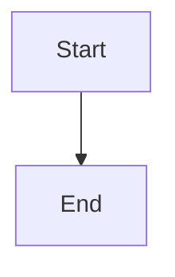

# Show coherent recovery progress on board and Historical transcript

## Parent Epic

epic_049

## Scope

Deliver epic_049 success criteria 4, 7 and 8 using the frozen shared projection and transcript page contracts from feat_049_001 and feat_049_002. Own operator integration and deterministic operational acceptance, not a separate recovery state machine.

Required Task acceptance:
- Show the current summary persistently on board and beside Historical: supported state/stage, owner, action/review, occurrence/freshness, attempt, prerequisite and safe next step. Preserve/link concurrent incidents. An old no-recovery-needed message stays dated authored history.
- Label milestones System · Recovery; distinguish authored manager/architect summaries. Link summary to stable milestone anchors and review; safely render text/URLs. Support keyboard navigation and load-older/incremental paging while preserving history/scroll.
- Board and room consume identical server semantics with action/generation/projection identity. Older async responses cannot regress current state or switch incidents silently; show freshness/lag explicitly.
- Deterministic fixture reproduces the supplied 03:58:01 queued, 03:58:10 acknowledged and 04:02:25 started timeline. Hold a role's final reply pending and prove through real supported HTTP/UI entry points that the live attempt and its milestone appear first.
- API and Chromium journey covers queued idle, acknowledgement, live investigation versus execution, checks/publication waits, expired/dead/inaccessible owners, failure/retry/exhaustion, new generation and authoritative verification. Publication success alone stays verification pending.
- Refresh, navigation, two-process duplicate delivery and service/worker restart preserve identity and exactly one milestone per material source transition. Include unknown legacy times, older authored health statements and competing incidents. Drive real notification/publication boundaries, not only prewritten expected UI fixtures.
- Assert recovery and chat GETs are read-only/bounded and make no provider/Git/process probes, raw full-history scans or paid turns. Record response/source bytes and representative warm navigation measurements. Existing tests may be extended; do not add redundant micro-tests or require a full repository suite by default.

Architecture closeout: reconcile the epic inventory against the integrated diff across context, container, components, cascade-dashboard-code, cascade-task-code, cascade-watchdog-code and affected workspace/teams Code views. Review root and War Room/Task/Watchdog/Workspace designs and interface owners. Verify model/source contract, real declaration kinds, supported pinned local rendering, context → container → component → Code, Level up, deep-link restore, opening pinned sources, renamed/deleted-symbol rejection and warm artifact reuse without per-view startup. Current model render success alone does not prove new coverage. Keep history in work records; do not rewrite accepted architecture artifacts. Report exact gaps rather than claim deployment or live tool-output streaming.

Preserve Codex feature_lead/feature_architect gpt-6-sol high and SWE gpt-5.6-sol medium. Use verified local Python/Node/Playwright/Chromium and pinned Structurizr tools without installation. Return focused commands/results and supported-entry-point evidence for Epic acceptance.

## Data structures

TBD.

## API contracts

TBD.

## Logic flow

## Task breakdown

_(empty — Feature Team mints tasks after dispatch)_

## Risks & upward questions

None.

## Decision log

None yet.
