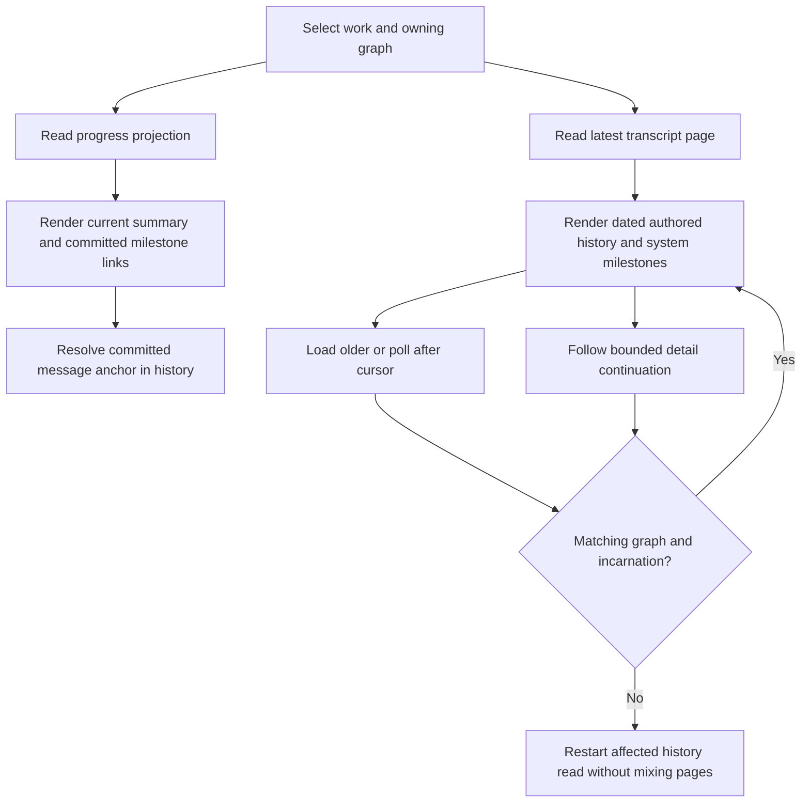

# Show coherent recovery progress on board and Historical transcript

## Parent Epic

epic_049

## Scope

Deliver epic_049 success criteria 4, 7 and 8 using the frozen shared projection and transcript page contracts from feat_049_001 and feat_049_002. Own operator integration and deterministic operational acceptance, not a separate recovery state machine.

Required Task acceptance:
- Show the current summary persistently on board and beside Historical: supported state/stage, owner, action/review, occurrence/freshness, attempt, prerequisite and safe next step. Preserve/link concurrent incidents. An old no-recovery-needed message stays dated authored history.
- Label milestones System · Recovery; distinguish authored manager/architect summaries. Link summary to stable milestone anchors and review; safely render text/URLs. Support keyboard navigation and load-older/incremental paging while preserving history/scroll.
- Board and room consume identical server semantics with action/generation/projection identity. Older async responses cannot regress current state or switch incidents silently; show freshness/lag explicitly.
- Deterministic fixture reproduces the supplied 03:58:01 queued, 03:58:10 acknowledged and 04:02:25 started timeline. Hold a role's final reply pending and prove through real supported HTTP/UI entry points that the live attempt and its milestone appear first.
- API and Chromium journey covers queued idle, acknowledgement, live investigation versus execution, checks/publication waits, expired/dead/inaccessible owners, failure/retry/exhaustion, new generation and authoritative verification. Publication success alone stays verification pending.
- Refresh, navigation, two-process duplicate delivery and service/worker restart preserve identity and exactly one milestone per material source transition. Include unknown legacy times, older authored health statements and competing incidents. Drive real notification/publication boundaries, not only prewritten expected UI fixtures.
- Assert recovery and chat GETs are read-only/bounded and make no provider/Git/process probes, raw full-history scans or paid turns. Record response/source bytes and representative warm navigation measurements. Existing tests may be extended; do not add redundant micro-tests or require a full repository suite by default.

Architecture closeout: reconcile the epic inventory against the integrated diff across context, container, components, cascade-dashboard-code, cascade-task-code, cascade-watchdog-code and affected workspace/teams Code views. Review root and War Room/Task/Watchdog/Workspace designs and interface owners. Verify model/source contract, real declaration kinds, supported pinned local rendering, context → container → component → Code, Level up, deep-link restore, opening pinned sources, renamed/deleted-symbol rejection and warm artifact reuse without per-view startup. Current model render success alone does not prove new coverage. Keep history in work records; do not rewrite accepted architecture artifacts. Report exact gaps rather than claim deployment or live tool-output streaming.

Preserve Codex feature_lead/feature_architect gpt-6-sol high and SWE gpt-5.6-sol medium. Use verified local Python/Node/Playwright/Chromium and pinned Structurizr tools without installation. Return focused commands/results and supported-entry-point evidence for Epic acceptance.

Architecture contract resolved by Epic decisions dec_004–dec_006. Required Task acceptance consumes the selected immutable progress/transcript pages and their distinct revision/incarnation contracts, renders pending milestone delivery and incomplete legacy import, preserves older-page cursors across ordinary appends, and rejects stale incarnation/cross-graph cursors. Test execution evidence with a queued live worker lacking an invocation token as a negative case. Verify both start fast path and supervisor replay while the authored final reply is held. Reconcile the current-source planning baseline's 13 Code nodes against actual producer/index/page implementations; no proposed function may remain represented as an implemented node.

## Data structures

### Confirmed upstream planning handoff

Feature 2 confirmation `feat_049_002:feat_049_002:ack_detail_contract_confirmed_20261125` is persisted in its canonical spec (reviewed revision `ac9ddcf32cd67965da38682847f59e183f78b1d7`, decisions dec_007–dec_008). This confirms planned interfaces, not completed implementation. Feature 2 owns their authoritative storage/API definitions; final source revision and route/error fixtures must arrive through the parent before UI integration acceptance.

Consume producer revision `dc47068cebf5643c319d37785edf35882fb96941` and `tests/war_room/fixtures/recovery_progress_v1_epic_044.json`, with `tests/war_room/test_recovery_progress_api.py` and `tests/war_room/test_http_read.py`. That fixture covers a waiting blocker, not the full operational timeline required above. Preserve receipt_id and entry_id unchanged, nullable legacy occurrence, safe target/provenance and ordered references. Success includes entry_count and entry schema_version/entry_revision; pending omits entry_count.

Feature 2 Task 002 owns `append_committed_recovery_receipt(root, receipt, snapshot)` and `recovery_progress.publisher.record_transcript_milestone(root, ack)`. The acknowledgement carries receipt_id, entry_id, graph_id, message_id, incarnation and append_sequence. JSONL fsync and index commit precede graph-fence release and publisher mapping; replay retries the same receipt through an append-before-ack crash and advances its source cursor only after durable mapping. UI consumes committed milestone_refs and renders delivery lag honestly; it must not synthesize anchors from unacknowledged receipts. Final fixtures must demonstrate an anchor resolving after replay without duplicate lines.

Transcript items distinguish recovery_milestone, role_reply and human, with nullable occurred_at separate from appended_at and direct/reconciled/legacy_unknown provenance. Feature 2 owns serialization; UI preserves these distinctions and safe rendering.

## API contracts

Consume Feature 1's completed `GET /api/recovery/progress?work_id=<id>&cursor=<opaque>`. Progress cursors bind work and projection revision; 400 invalid_request and 409 revision_changed remain distinct, with restart plus previous_revision/current_revision on conflict. Preserve typed pending evidence states rather than interpreting them as healthy empty recovery.

Feature 2 owns these confirmed planned endpoints:
- `GET /api/transcript/v1/<graph_id>?direction=older|after&cursor=<opaque>&limit=<n>`: latest 50 by default, maximum 100; envelope includes schema_version, graph_id, incarnation, high_water_mark, completeness, observed_at, items, older_cursor, after_cursor and has_more. Older paging retains its high-water across appends; incremental paging follows committed append sequence.
- `GET /api/chat/<graph_id>`: bounded legacy array with Link continuation and X-Transcript-Completeness, X-Transcript-Incarnation and X-Transcript-Has-More headers. Typed 503 transcript_unavailable must not appear as a healthy empty history.
- `GET /api/transcript/v1/<graph_id>/items/<message_id>/detail?cursor=<opaque>`: detail_truncated/detail_url/detail_cursor preview metadata leads to immutable UTF-8-aligned chunks of at most 64 KiB. Envelope contains schema_version, graph_id, message_id, incarnation, encoding, chunk, next_cursor and complete; verify exact serialized chunk field against final fixtures before implementation.

Transcript page cursors bind graph/incarnation/direction/position/high-water; detail cursors bind graph/incarnation/message/digest/offset. Consume typed 400 invalid_request, 409 cursor_restart and 503 history_pending using Feature 2's final fixtures; restart conflicts include restart, current_incarnation and restart_url for transcript pages. Reject late responses from a replaced graph/incarnation, keep progress revision separate from transcript incarnation, and never splice incompatible detail chunks. Explicitly show incomplete import and pending history.

Required UI acceptance includes preview-to-detail continuation, stale detail cursor recovery and a wrong-graph rejection. All endpoints retain 1 MiB aggregate source and 256 KiB response budgets and read only immutable projections. No UI refresh repairs storage or invokes providers, Git, checkpoints or recovery.

## Logic flow

Planned consumer flow; reconcile with final upstream fixtures and implemented UI:

## Task breakdown

_(empty — Feature Team mints tasks after dispatch)_

## Risks & upward questions

Post-merge Feature 2 review at 7f7df0e8 reproduced stale routing regression through the private publisher acknowledgement path. Corrective feature feat_049_004 is a required dependency before dispatch/integrated acceptance. Consume its verified final source and fixtures; completed Feature 2 lifecycle does not establish acceptance of this race. No UI workaround or independently inferred acknowledgement ordering is authorized.

## Decision log

None yet.
