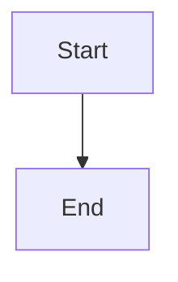

# Keep Feature delivery ownership alive until verified integration

## Parent Epic

epic_051

## Scope

Define one additive Feature delivery lifecycle over the existing review registry and current obligation/repair evidence. Separate implementation readiness, review pending, repair requested/in progress, merge verification pending, verified integration and supported terminal cancellation/closure. Preserve the existing board status schema and completed-source-document publication convention; completed Markdown staging is not authority to retire a team or satisfy downstream integration. The public delivery projection must make that distinction explicit.

Own review.py lifecycle/projection and generation compatibility; boss/rollup.py completion/retirement consumers; workspace/kickoff.py ordinary delivery, startup resume and locked invocation eligibility; integration_worktree.py retention/retirement proof where required. Retain the Feature ID, registered branch/path, checkpoints, queue and original review while its delivery obligation is nonterminal. A dormant owner is eligible only for a new actionable event/current admitted repair or interrupted turn; a polling pass alone launches no role turn. Nonterminal ownership does not grant permission to mint a repair Task without admission. Read-only projection never polls the forge or writes lifecycle state.

Acceptance: all children completed plus an open PR retains ownership and integration-dependent blockers; no premature FeatureCompleted/retirement; duplicate polls produce zero paid turns; a new authorized event or interrupted delivery can resume the same team under one writer. Legacy completed-but-open records normalize to nonterminal review ownership without inventing accepted heads, resetting history or opening a PR. Unknown/missing review evidence stays explicit and retains resources. Verified direct or supported stacked integration into the intended Epic is required before normal retirement. Closed-unmerged reviews remain blocked unless an explicit supported terminal disposition exists; cancellation must retain its existing proof and parent-disposition gates. Preserve review-disabled/local-integration behavior and split product/tracking ownership.

Extend focused completion, review-generation, completed-recovery-kickoff, rollup and retirement tests using real temporary Git where identity/integration matters. Design owners: cascade/DESIGN.md (shared review lifecycle), cascade/boss/DESIGN.md (closeout), cascade/workspace/DESIGN.md (wakeup and retained ownership); root DESIGN.md summarizes. Views: cascade-boss-code, cascade-workspace-code, cascade-supervisor-components and cascade-team-components; add or update source-linked nodes for shared review predicates, completion, queue admission and retirement. Link existing REQ-REVIEW-REPAIR-001/002, REQ-BOSS-CLOSEOUT-001 and REQ-WORKSPACE-RETIRE-001; allocate any new local IDs in the single owner.

### Required Task acceptance and design handoff

Feature planners must carry the relevant acceptance cases below into executable Task specifications. Tasks update the owning DESIGN.md, affected parent/consumer links, model.dsl, views.dsl and workspace.contract.json together where behavior changes. Stable requirement/decision IDs have exactly one design owner. Preserve the existing revision-pinned architecture review workflow and accepted artifacts. Each changed component needs a native Structurizr Code view with real source paths/symbols, correct declaration kinds, and matching cascade.codeComponent/cascade.parent metadata. Record normal and failure/restart traces, source-contract checks, pinned render evidence, and actual context → container → component → Code / Level up / deep-link / pinned-source verification in work closeout; a render alone is insufficient. No delivery chronology belongs in DESIGN.md. Do not add a scheduler, recovery ledger, provider launcher, approval bypass, or new review for an already-open original review. No software installation or deployment is authorized.

## Data structures

TBD.

## API contracts

TBD.

## Logic flow

## Task breakdown

_(empty — Feature Team mints tasks after dispatch)_

## Risks & upward questions

None.

## Decision log

None yet.
