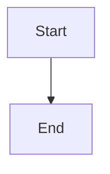

# Admit durable scoped repairs for open Feature reviews

## Parent Epic

epic_051

## Scope

Provide one guarded request → admission → wakeup → repair route for direct-parent and authenticated human fix requests against the existing open Feature review. Extend feature/repair.py and the current action ledger; do not require an unrelated Task lifecycle mismatch to admit a review repair. Route team_supervision.py and epic/recovery.py through this adapter. Integrate existing human mutation entry points, Feature scoped tools, mint_task/reserve_repair_child, publication and Watchdog authorization/independent postchecks. Keep a request acknowledgement distinct from executable admission, execution and verified outcome.

Persist request identity, scoped reason/evidence, accountable Feature, original review URL/forge/source-target route, observed head pair, repair generation, approval/scope authority, claim and existing budget identity before scheduling. Recheck mutable gates under the current lifecycle/owner lock. Reuse request and reserved child on replay; same request ID with changed content refuses. Concurrent requests/turns must join or defer to one current owner, never create competing writers. Stale head/generation/owner evidence refuses or requests fresh observation. Missing approval, unresolved governing comments, changed scope, dependencies, cancellation, exhaustion or unavailable forge evidence produce a typed next prerequisite; legitimate scoped review response must not need a human to resolve its own fix request before work can begin. Broader changes use existing amendment/approval paths.

Acceptance: implementation-complete/open-red-PR + parent fix request becomes a durable admitted generation, resumes the retained Feature, mints/dispatches a scoped repair Task through normal guarded tools and refreshes the same PR. Human and parent requests converge on that adapter. Crash after admission/before enqueue, after enqueue/before checkpoint and during child reservation resumes exactly once. Typed results expose requested/admitted, acknowledged, executing/executed, refused/waiting, verification pending/verified and the next prerequisite with action/generation identity. Legacy completed-open Feature follows supported repair reconciliation, not a manual board edit. Existing accepted/merged-review follow-up behavior remains outside this open-review route. Independent postcheck binds corrected source, current required-check evidence, accepted review generation and intended-target integration before verified outcome/retirement. Claims and finite incident/provider/validation budgets survive restart and cannot reset on duplicates.

Tests: feature repair, Epic direct-parent recovery, kickoff, mint reservation, publication safeguards and parent lifecycle postcheck suites; use fault injection at durable boundaries and a concurrent worker case, not mock-only state assertions. Design owners: cascade/feature/DESIGN.md (repair), cascade/epic/DESIGN.md (parent API), cascade/watchdog/DESIGN.md (independent postcheck), cascade/task/DESIGN.md only if its contract changes. Views: cascade-feature-code, cascade-epic-code, cascade-watchdog-code and affected cascade-task-code/cascade-teams-code. Trace actual feature_repair, reserve_repair_child, mint_task, recover_feature, supervise_child, repair_event_authorizes and postcheck symbols. Extend existing REQ-FEATURE-REPAIR-001/002 and shared review/owner contracts without duplicating them.

### Required Task acceptance and design handoff

Feature planners must carry the relevant acceptance cases below into executable Task specifications. Tasks update the owning DESIGN.md, affected parent/consumer links, model.dsl, views.dsl and workspace.contract.json together where behavior changes. Stable requirement/decision IDs have exactly one design owner. Preserve the existing revision-pinned architecture review workflow and accepted artifacts. Each changed component needs a native Structurizr Code view with real source paths/symbols, correct declaration kinds, and matching cascade.codeComponent/cascade.parent metadata. Record normal and failure/restart traces, source-contract checks, pinned render evidence, and actual context → container → component → Code / Level up / deep-link / pinned-source verification in work closeout; a render alone is insufficient. No delivery chronology belongs in DESIGN.md. Do not add a scheduler, recovery ledger, provider launcher, approval bypass, or new review for an already-open original review. No software installation or deployment is authorized.

## Data structures

TBD.

## API contracts

TBD.

## Logic flow

## Task breakdown

_(empty — Feature Team mints tasks after dispatch)_

## Risks & upward questions

None.

## Decision log

None yet.
