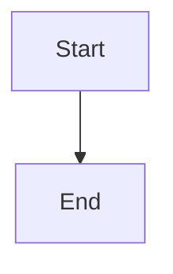

# Route actionable review health without idle or downstream retry loops

## Parent Epic

epic_051

## Scope

Extend tracking.merge_request_snapshot and review_health.reconcile_open_review_health to normalize fresh review identity/head pair, mergeability, required CI requirements/results and review feedback for GitHub and GitLab. Preserve unknown/unavailable evidence explicitly. Identify required checks from authoritative forge policy/evidence; absence of reported checks is not proof of no required checks. CI results bind their source/check-run generation and relevant target evidence. Pending checks, unavailable policy/data, transient forge errors, approval waits, fixable failed checks and conflicts remain distinct. A mergeable PR with a failed required check must never be healthy.

Reuse current Watchdog review polling, resolution-action routing, incident/claim budgets and the preceding durable repair API. Normalize material observation identity from original review, head pair, failing/check-run or feedback identity and current repair generation. Repeated identical evidence reuses the admitted request without another Task, model turn or budget reset. New source/target/check-run/feedback evidence may justify bounded reevaluation. Preserve safe existing conflict validation/republication and required human merge policy; do not launch arbitrary CI commands from forge text, blindly rerun failed checks, merge PRs or override protections.

Acceptance: classify failed/pending/missing/stale/green required checks, approval-only waits, actionable human feedback, conflicting/moving target, transient forge outage and terminal disposition using production normalization with scripted transport. Changed heads or a green result for an old source cannot satisfy repair or closeout; transient/pending/unchanged polling launches no provider. Conflicts and failed checks share one generation-bound Feature repair owner instead of competing writers. Independent observation reconciles the exact corrected head and all known required checks before success, then verifies intended-target merge. Persist the upstream review blocker/evidence generation on affected downstream recovery so unchanged upstream CI cannot repeatedly redispatch the downstream Task; changed evidence releases reevaluation once through current dependency/recovery gates. Never suppress an unrelated downstream failure. Restart preserves deduplication, budgets, latest evidence and pending delivery.

Tests: tracking adapter, review health/rebase, resolution actions, Watchdog reservations/postchecks, downstream queued-delivery/recovery and publication safeguard cases. Design owners: cascade/DESIGN.md (forge/check contract), cascade/watchdog/DESIGN.md (observation/recovery), cascade/task/DESIGN.md where downstream retry semantics change. Views: cascade-watchdog-code, cascade-boss-code, cascade-teams-code and cascade-task-code as affected, plus component relationships. Show normal red → admitted repair → new head pending → green → verified merge and unknown/human gate/restart paths in owning designs. Prefer a small extension to existing records and adapters; no second scheduler or CI service.

### Required Task acceptance and design handoff

Feature planners must carry the relevant acceptance cases below into executable Task specifications. Tasks update the owning DESIGN.md, affected parent/consumer links, model.dsl, views.dsl and workspace.contract.json together where behavior changes. Stable requirement/decision IDs have exactly one design owner. Preserve the existing revision-pinned architecture review workflow and accepted artifacts. Each changed component needs a native Structurizr Code view with real source paths/symbols, correct declaration kinds, and matching cascade.codeComponent/cascade.parent metadata. Record normal and failure/restart traces, source-contract checks, pinned render evidence, and actual context → container → component → Code / Level up / deep-link / pinned-source verification in work closeout; a render alone is insufficient. No delivery chronology belongs in DESIGN.md. Do not add a scheduler, recovery ledger, provider launcher, approval bypass, or new review for an already-open original review. No software installation or deployment is authorized.

## Data structures

TBD.

## API contracts

TBD.

## Logic flow

## Task breakdown

_(empty — Feature Team mints tasks after dispatch)_

## Risks & upward questions

None.

## Decision log

None yet.
