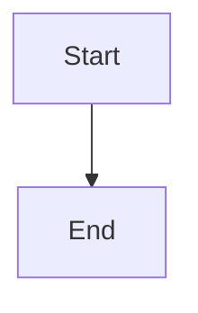

# Expose accountable review state and prove the complete repair journey

## Parent Epic

epic_051

## Scope

Extend existing Feature review projection, War Room board/open-review/room surfaces, recovery progress and committed transcript mechanisms to show original PR URL, accountable Feature, implementation versus delivery state, CI/feedback freshness, repair request/generation, verified status and next prerequisite. Reuse the existing authenticated human action route from durable repair admission and display its typed result. Review-pending must remain visibly awaiting review rather than inactive/terminal. Read-only GET, browser polling, attaching or opening a plan must not poll the forge for authority, mutate records, enqueue work or start a provider. Avoid parallel status stores, transcript formats or new dashboard frameworks.

Own final acceptance spanning the preceding Features: reproduce the motivating implementation-complete Feature/open-red-CI review with a parent fix request, durable admitted Task on the retained Feature branch, production guarded delivery/publication, scripted fresh green CI, human-policy-compatible merge observation into its Epic, independent postcheck and only then retirement. Use real temporary Git repositories and real production orchestration; script forge/check/provider transport as necessary and state that boundary. Assert stable Feature/branch/PR identity, no duplicate PR or Task, no manual board edits, no approval bypass, retained comments, preserved checkpoints/history, no unchanged idle provider turns and no downstream rerun storm. Include split product/tracking coverage.

The acceptance matrix also covers target movement/conflicts, actionable feedback, stale and duplicate requests, restart after admission before wake, one-writer concurrent repairs, missing forge/check policy, required human approval, budget exhaustion, cancellation/closed-unmerged and legacy completed-open review. Extend existing late-repair/review-recovery journey tests instead of cloning a second large harness. Run focused suites and the existing bounded Recovery contract gate; add the new journey to that gate if its coverage is otherwise absent. Exercise UI state transitions with a real browser and prove GET-only activity cannot invoke providers or mutate lifecycle evidence.

Reconcile the entire epic diagram-impact inventory against final code. Design owner cascade/war_room/DESIGN.md; recovery_progress/DESIGN.md changes only if its published contract changes; coordinate other owners through parent artifacts. Views cascade-dashboard-code, cascade-war-room-http-code if action wiring changes, cascade-war-room-components, and final validation of all affected team/Workspace/Watchdog/Boss Code views. Verify source symbols/declaration kinds/ownership, renamed/deleted nodes, context → container → component → Code, Level up, deep links and pinned-source opening. Use the pinned renderer with existing bounds, report cold and warm measurements and cache reuse, and verify no per-view process startup. Preserve accepted snapshots and use revision-pinned publication. Record a concrete reason for each unchanged architecture level and all material limitations in closeout; do not claim new acceptance from baseline tests alone.

### Required Task acceptance and design handoff

Feature planners must carry the relevant acceptance cases below into executable Task specifications. Tasks update the owning DESIGN.md, affected parent/consumer links, model.dsl, views.dsl and workspace.contract.json together where behavior changes. Stable requirement/decision IDs have exactly one design owner. Preserve the existing revision-pinned architecture review workflow and accepted artifacts. Each changed component needs a native Structurizr Code view with real source paths/symbols, correct declaration kinds, and matching cascade.codeComponent/cascade.parent metadata. Record normal and failure/restart traces, source-contract checks, pinned render evidence, and actual context → container → component → Code / Level up / deep-link / pinned-source verification in work closeout; a render alone is insufficient. No delivery chronology belongs in DESIGN.md. Do not add a scheduler, recovery ledger, provider launcher, approval bypass, or new review for an already-open original review. No software installation or deployment is authorized.

## Data structures

TBD.

## API contracts

TBD.

## Logic flow

## Task breakdown

_(empty — Feature Team mints tasks after dispatch)_

## Risks & upward questions

None.

## Decision log

None yet.
