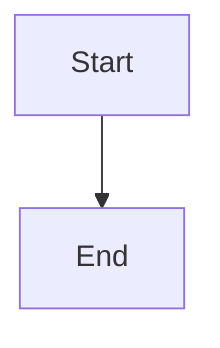

# Close delivery-consumer and cross-Feature recovery acceptance gaps

## Parent Epic

epic_051

## Scope

Bounded follow-up for epic_051 dec_010, closing existing success criteria 1, 4 and 6 and dec_008/dec_009; do not broaden the product contract or reopen accepted child records manually.

Reproduce the integrated 95bc9af4 discrepancy using real temporary Git and normal configured approval/activation: a completed Feature with a closed-unverified review has feature_delivery_view.phase=merge_verification_pending and blocker=accepted_current_generation_missing, while feature_review_pending=false, watchdog.dispatch._deps_met=true and _dependency_review_pending=false. Inventory integration-required consumers in cascade/watchdog/dispatch.py, cascade/stacked_dispatch.py and recovery dispatch. Make their execution gate consume coherent delivery evidence for closed-unmerged, missing, stale generation and accepted-but-not-intended-target-integrated reviews. Keep cascade/dependency_evaluation.py's lifecycle planning readiness separate; preserve intentionally supported stacked dispatch. Prove verified intended-target integration releases the appropriate gate exactly once.

Demonstrate an upstream Feature with unchanged red CI cannot cause repeated execution/validation of a dependent Feature's Task across supervisor passes and restart. record_upstream_review_observation currently selects only queued Tasks owned by the observed Feature. Trace the actual cross-Feature path before changing it; add only the necessary source-bound blocker routing/fencing using existing actions, generations and budgets. A material evidence change permits one ordinary gated reevaluation; unrelated failures remain independently actionable. Script external forge/provider transport only where needed and name those seams.

Repair relevant fixture setup in tests/workspace/test_kickoff.py and tests/test_feature_closeout_flow.py through normal activation and configured approval, without bypassing guards. Current integrated run has 24 passed and the same 17 historical failures: 16 existing_child_work activation refusals and one missing-agent-configuration approval refusal. Restore assertions that actually reach idle/no-provider and dependent-feature release behavior; do not add broad unrelated test cleanup. Reuse late-repair and review-recovery harnesses and the existing bounded Recovery contract gate.

Task acceptance must reconcile affected owning designs and architecture source/contract together. Diagram inventory: context/landscape and containers retain current actors/stores absent a concrete diff; cascade-supervisor-components and cascade-team-components cover dependency/recovery collaborations; cascade-task-code, cascade-watchdog-code, cascade-boss-code and affected cascade-feature-code/cascade-workspace-code/cascade-epic-code show actual gate, observation and retry symbols with native declaration kinds and one component owner. Preserve source links and explain normal/restart/failure paths in owning designs; no delivery history in DESIGN.md. Validate source contracts, real pinned rendering, context-to-Code navigation, Level up, deep links and pinned source, stale symbol/ownership checks and warm artifact reuse. Record specific no-change reasons per unaffected view. Preserve accepted snapshots and revision-pinned publication; Epic Architect owns final integrated publication.

No scheduler, ledger, provider launcher, second PR for an open review, approval/CI bypass, dependency installation or live deployment. Keep original Feature/branch/review identity and finite budgets. Completion requires concrete consumer and cross-Feature evidence, bounded relevant checks, design reconciliation and explicit remaining limitations.

## Data structures

TBD.

## API contracts

TBD.

## Logic flow

## Task breakdown

_(empty — Feature Team mints tasks after dispatch)_

## Risks & upward questions

None.

## Decision log

None yet.
