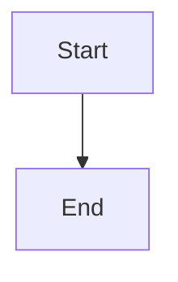

# Separate durable Feature approval from execution dependency gates

## Parent Epic

epic_056

## Scope

# Separate durable Feature approval from execution dependency gates

## Scope
Implement the approval boundary described by epic_056. A human may approve the current reviewed Feature scope while a known, structurally valid ordinary predecessor is incomplete. Approval never claims readiness or starts work before canonical execution gates pass.

Own cascade/approvals.py, planning_action_dependencies.py, dependency_evaluation.py only as needed, feature/readiness.py and readiness_evidence.py, and the approval HTTP response/projection contract. Preserve shared strict dependency checks for minting, Epic sign-off, dispatch and other planning actions. Reuse existing approval evidence, Watchdog/Boss dispatch and lifecycle review gates.

## Acceptance criteria
1. Trace every authorization gate before changing the individual Feature approval path. Keep current human identity, reviewed revision/context, corrective-plan, provider, architecture/comment and applicable software-manifest gates. Allow only known noncancelled predecessor incompleteness at this boundary. Missing dependency/source, cancellation and illegal status/column evidence refuse explicitly without mutating approval.
2. Define approval eligibility separately from dispatch readiness on the server. Preserve legacy response/projection fields; expose typed approval result, explanation, affected work IDs and canonical approval state. A successful saved approval followed by dispatch refusal remains a successful approval with waiting evidence.
3. Persist approval through existing document timestamp and feature_approvals.json evidence. Retain scope versus exact approval modes; review-context races and changed scope invalidate approval. Review dependency-declaration changes as part of this fence. A crash between document/evidence writes must remain non-dispatchable and recover through the existing approval path.
4. Refresh authoritative owner/dependency evidence under existing concurrency fences. Repeated/concurrent approval calls and later Watchdog/Boss ticks admit one Feature execution; approved work waits in backlog. No planning or Tasks run while dependencies, sibling activity, required integration, review, provider or software gates block.
5. Keep Epic bulk approval and late-child behavior consistent with the explicit contract: existing included children stay approved, newly minted children remain unapproved until explicit human approval, and repeated approval cannot accept stale reviewed scope.
6. Extend production API plus isolated real-Git tests from tests/test_planning_action_dependencies.py, test_approvals.py, test_approval_dispatch_integration.py and tests/war_room/test_late_mint_feature_approval_e2e.py. Cover incomplete/unknown/cancelled/regressed dependencies, software safety, architecture/provider refusal, stale review and scope, restart, duplicate/concurrent calls and unrelated blockers. Prove predecessor completion alone does not bypass required delivery evidence.
7. Update owning design requirements and diagrams with actual implementation. Feature team must put this acceptance criterion into its Tasks: reconcile cascade/DESIGN.md approval authority, cascade/feature/DESIGN.md evidence lifecycle, affected Watchdog interfaces, root links, and source-backed integrated Code coverage for approval/evaluation/evidence/dispatch. Preserve model-contract semantic IDs and pinned review workflow; validate source symbols, local rendering, Context→Containers→Components→Code, Level up, deep-link restore and pinned source opening. Record normal and failure/restart traces and any unchanged-view rationale.

## Dependencies
None. Software prerequisites are inherited from the owning Epic manifest.

## Non-goals
No new scheduler, approval ledger, automatic human approval, installation, deployment, blanket relaxation of require_action_dependencies, or change to supported stacked dispatch semantics.

## Task breakdown
Feature lead and architect split bounded implementation and meaningful tests after reviewing the Epic's architecture inventory; every affected Task includes design and Code-view acceptance criteria.

## Data structures

TBD.

## API contracts

TBD.

## Logic flow

## Task breakdown

_(empty — Feature Team mints tasks after dispatch)_

## Risks & upward questions

None.

## Decision log

None yet.
