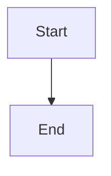

# Show Feature approval outcomes and verify deferred dispatch end to end

## Parent Epic

epic_056

## Scope

# Show Feature approval outcomes and verify deferred dispatch end to end

## Scope
Consume feat_056_001's authoritative approval eligibility and result contract in the War Room board and plan-page controls. Make pending, saved-but-waiting, explicit refusal, and unknown transport outcomes visible on the affected work item without reload. Complete the real-browser/API/Git journey required by epic_056.

Own cascade/war_room/static/war_room.js, plan_viewer.js, epic_plan_readiness_ui.js and associated rendering/serialization only where needed. Reuse existing lifecycle action tracking and readiness projections; do not compute approval or dispatch permission in the browser.

## Acceptance criteria
1. Both applicable approval surfaces submit the exact displayed reviewed context/revision. Missing or stale context produces an actionable refusal, never approval of unseen scope. Preserve Epic plan approval behavior and the distinction between Feature authorization and later tactical planning.
2. Click immediately disables its action and shows pending. Repeated clicks, rerenders and out-of-order polls cannot clear the in-flight state or duplicate POSTs. Existing transport deadlines remain bounded.
3. Successful durable approval shows approved-awaiting-prerequisite with typed reasons and work IDs until canonical readiness advances. A received explicit refusal appears on that row/control across subsequent polls with a retry or existing corrective action; it must not be relegated to chat status.
4. Timeout/disconnect is unconfirmed, not rejected or accepted. Reconcile with canonical state before reporting success or enabling an unsafe duplicate action; stale polling responses cannot override confirmed newer evidence. Persisted approval survives page/server restart; transient action messages do not become a new authorization ledger.
5. With the production HTTP service and isolated real Git, reproduce feat_051_006 depending on active feat_051_005 using fixture identities: approve once, refresh/restart, verify persisted current evidence and zero premature Feature/Task starts, complete and verify the predecessor, then observe exactly one canonical dispatch without a second approval click. Retain sibling/integration/review blockers until independently cleared.
6. Browser tests cover late-minted approved/unapproved children, delayed requests, repeated clicks and polls, refusal with IDs, stale reviewed scope, provider/architecture/software refusal, transport failure and keyboard/screen-reader feedback. Exercise API-backed behavior; static source assertions alone are insufficient. Count dispatch events/leases rather than treating an enabled button as execution proof.
7. Update cascade/war_room/DESIGN.md requirements REQ-WARROOM-READINESS-001 and DEC-WARROOM-READINESS-001 with the API/client boundary and action-state flow; reference the approval requirement owned by cascade/DESIGN.md. Reconcile source-backed cascade-war-room-http-code and cascade-dashboard-code plus affected component views and workspace.contract.json. Each Task must include the relevant diagram-impact row and source symbols in acceptance criteria.
8. Validate pinned source links, render through supported local tooling, and exercise Context→Containers→Components→Code, Level up and deep-link restoration. Include representative renamed/deleted-symbol and ownership-mismatch rejection checks from existing architecture tests, and measure warm navigation reuse without per-view process startup or relaxed render bounds. Record actual measured evidence and limitations, not a universal performance claim.

## Dependencies
depends_on: feat_056_001. Consume its completed API/projection contract; do not implement a competing approval authority.

## Non-goals
No new attention/notification product, broad UI redesign, scheduler, deployment, approval ledger or live mutation of the incident Features.

## Task breakdown
Feature lead and architect assign UI implementation and one focused end-to-end delivery slice. Extend existing browser/API fixtures instead of duplicating lower-level tests.

## Data structures

TBD.

## API contracts

TBD.

## Logic flow

## Task breakdown

_(empty — Feature Team mints tasks after dispatch)_

## Risks & upward questions

None.

## Decision log

None yet.
